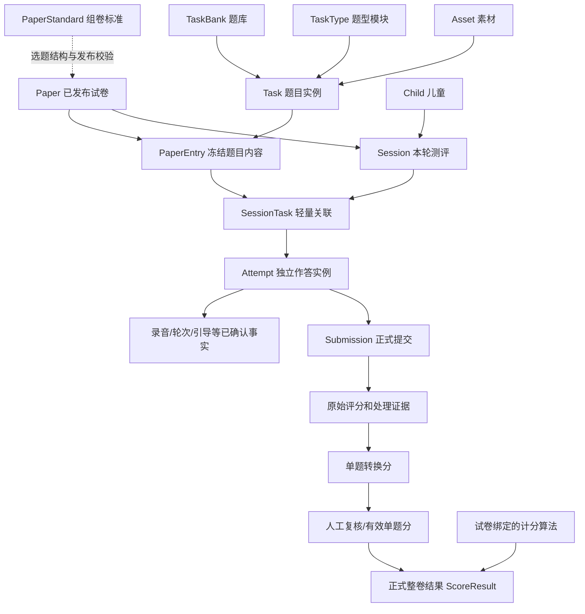

# 学前儿童普通话测评系统 VNext｜总体架构初步设计报告

> **文档编号：** VNEXT-ARCH-001<br>
> **版本：** v0.1（核心架构决策基线，专项设计前）<br>
> **整理日期：** 2026-10-29<br>
> **状态：** 核心原则与对象边界已确认；题型状态图、接口细节及数据库模式待专项设计<br>
> **目标仓库：** `ZhongYun999/preschool-mandarin-assessment-rebuild`（Public）<br>
> **参考仓库：** `ZhongYun999/preschool-mandarin-assessment`（仅供业务行为与实现参考）

## 0. 文档目的、范围与适用规则

本报告将 VNext 重构讨论中已经明确的总体架构决策集中为一个可长期引用的设计基线，用于指导后续专项设计、Issue 拆分、代码实现、测试及代码审查。它说明**概念与责任边界**，不提前决定各业务概念必须对应多少个 Python 类、数据库表或文件。

**适用范围：** 题型、题目和题库、组卷标准与试卷、测评会话与任务、作答过程、正式提交与处理、原始评分、单题转换分、人工复核、整卷计分、数据持久化、公共模型/音频能力、前后端责任及相关演进要求。

**不在本阶段冻结：** 各题型全部状态和事件枚举、具体评分公式及权重数值、完整数据表定义、HTTP API 路径、教师页面与小程序布局、文件目录结构、具体音频恢复协议、教师复核操作界面、部署细节。这些由后续专项文档决定，不得因本报告出现示意名称便将其擅自视为最终实现约束。

### 0.1 决策效力

- **【确定】**：用户已确认的目标或架构原则，后续实现必须遵守；若业务明确变更，先更新设计文档再变更代码。
- **【设计建议】**：为落实已确定原则提出的实现方向；可在专项设计中调整，但需说明原因。
- **【待专项确认】**：尚无足够业务信息，不得由实现者随意填入武断限制或假定规则。

同一主题的专项设计经过确认后，可以在不违背本报告核心原则的条件下对细节作更精确规定；发生原则冲突时，先讨论并修订本报告，不进行静默覆盖。**新仓库以确认后的设计文档为实现依据；旧仓库的实际代码不是新架构规范。**

## 1. 系统目标与总原则【确定】

1. **从业务概念出发重新构建。** 旧系统只用于参照可复用实现和历史业务事实，不采用“将旧代码逐层补丁式迁移”作为设计原则。
2. **业务规则单一权威来源。** 一项规则只由明确的业务所有者定义；避免在数据库默认值、题型服务、HTTP 路由和小程序中分别维护一份可互相矛盾的判定。
3. **题型与学段解耦。** 学段是儿童/题目/测评的普通上下文或检索分类，不是题型使用许可证。新增任意合理学段标识，不应因不在 `small/middle/large` 白名单而无法调用已经注册的题型。
4. **不擅自设置限制。** 不在公共模型中预设 Attempt 次数、Submission 次数、追问次数、录音时长等任意上限；实际需要的业务阈值由对应题型的明确可配置规则决定。必要的身份授权、数据完整性、幂等、明确生命周期转换不属于无意义限制。
5. **题型互相隔离。** 各题型拥有独立的作答状态机和状态数据，可共享音频、存储、ASR/ISE/LLM/TTS 与提交处理基础能力；不得直接读写其他题型的内部状态。
6. **当前运行政策用于未完成操作。** 例如中班 Speaking 最低时长从 30 秒改成 45 秒时，昨日已确认保存的 35 秒录音仍然保存，但恢复后申请结束/提交须按当前 45 秒政策判断。系统不为人为修改运行政策设计额外的跨版本自动纠错系统。
7. **发布内容与计分语义稳定。** 已发布试卷不可原地修改；试卷发布时确定其有效组卷标准依据、单题转换规则及整卷计分算法/参数。已用于发布试卷的算法身份及计算语义不得原位变更；变更意味着使用新版本或新标识。
8. **结果固化。** 原始评价证据、单题转换结果和复核事实按各自业务阶段持久化；整卷正式结果必须等单题结果准备完毕且不存在待复核项后，使用试卷绑定算法计算并一次性固化。查询、统计、导出不临时重新评分或重新计分。
9. **前端是交互工具。** 教师网页与小程序可执行必要的输入格式检查、引导、显示与操作；业务资格、状态迁移和正式计分由后端业务层最终裁决。
10. **公共能力保持公共。** 外部模型服务商调用、文件存储、音频处理、消息任务等属于共享基础设施；各业务模块拥有自己的业务目标、提示词需求和裁决规则。

## 2. 三层总体架构【确定】

| 层次 | 主要内容 | 权限与职责边界 |
|---|---|---|
| **业务核心 Domain** | TaskType、Task、TaskBank、PaperStandard、Paper、Session、SessionTask、Attempt、Submission、原始评价证据、单题转换、复核、ScoringAlgorithm、ScoreResult | 定义业务事实、参数归属、合法状态转换、有效成绩与最终结算 |
| **公共能力 Infrastructure** | 持久化实现、文件/音频存储、ASR、ISE、LLM、TTS、提示词模板基础设施、后台工作任务、日志和外部服务适配 | 提供可调用能力；不自行决定题型是否结束、哪次作答有效、会话是否结算 |
| **应用与展示 Application** | HTTP/API、教师网页、小程序、管理操作、结果查询、统计分析和导出 | 接受操作、调用业务用例、展示返回状态/已固化结果；不重复实现业务裁决 |

业务核心可以通过抽象接口请求基础设施能力，但不应直接被具体厂商 SDK、小程序页面或某条 HTTP 路由的设计反向控制。业务模块可以定义其提示词需求；公共提示词/模型设施负责管理、构建与执行调用。

### 2.1 核心逻辑关系



图示为主要业务关系，不等于表关系或单向实现依赖。题型内部状态由各自业务模块拥有；Session 只消费统一的单题进度与结果就绪视图。

## 3. 四组核心对象与所有权【确定】

### 3.1 A 组：测评资源定义

| 概念 | 业务身份和责任 | 不负责 |
|---|---|---|
| **TaskType 题型** | 注册一种题型，定义该题型的事件、状态转换、固有能力和运行用例 | 管理某名儿童的当前状态；判断未列入白名单的学段不可用 |
| **Task 题目** | 某题库中的独立题目实例；记录题干、素材关联、参考内容、题型标识、检索信息及允许的题目特定参数 | 替题型重复存储全部固有能力；决定整卷权重 |
| **TaskBank 题库** | 组织独立题目，供教师维护和组卷 | 使不同题库中相同内容的题目共享身份、状态或修改结果 |
| **Asset 素材** | 管理图片、音频等资源、来源和可访问的稳定引用 | 裁决作答完成、正式评分及 Session 结果 |

**题库归属的明确合同：** 每个 Task 只属于一个 TaskBank；禁止一个 Task 同时归属多个题库。若两个题库分别保存一份内容完全相同的题目，必须当作**两个互不关联的 Task 实例**，独立编辑、发布、归档；不得基于内容一致自动去重为共享题目。素材资源可依实际需要复用，素材复用不改变题目身份独立性。

**学段的明确合同：** `grade_level` 是上下文和可选的匹配/默认参数条件，不是 `TaskType` 的授权条件。试卷要求匹配某个学段可以是该试卷的明确选择规则；这不等于禁止该学段使用其他题型。题型是否存在以题型注册为准，不使用固定学段白名单判定题型能力。

### 3.2 B 组：组卷标准与试卷

| 概念 | 责任 |
|---|---|
| **PaperStandard 组卷标准** | 按配置或规则描述题型数量、结构、顺序等组卷要求，校验试卷是否满足；以独立可选择模块扩展 |
| **组卷操作服务** | 执行教师手动选择、自动选题、补齐缺口及排列题目等行为，应用所选标准但不是标准本身 |
| **Paper 试卷** | 代表已选定的有序题目集合及发布身份、所采用的标准依据、评分规则引用和发布资源 |
| **PaperEntry / PaperTask** | 代表试卷中的一道题及其固定顺序；发布时持有/指向不可变的题目内容 |
| **发布资源准备** | 发布过程中使用公共 TTS 能力准备必要的固定语音，并与发布内容稳定关联 |

- **【确定】** 三类可扩展模块是轻量的**题型模块、组卷标准模块、计分算法模块**，不是动态下载/热加载的通用插件平台或 MC 模组加载器。
- **【确定】** 组卷标准负责“需要多少题、怎样组织”等标准，不负责勾选、随机抽题、自动补题等操作服务内部过程。
- **【确定】** 试卷发布后题目内容、题序、组卷依据和评分依据不得原地修改。需要修改时从当前/旧内容生成另一份草稿并重新发布，不篡改既有发布内容。
- **【确定】** 正式 Session 必须来自**已发布试卷**。不设计绕过发布试卷直接从题库创建 Session 的正式或调试特例。
- **【待专项确认】** 一次组卷选择一个标准还是明确组合多个标准、自由组卷如何表示。不可武断将当前所有试卷限制为恰好一个标准，也不可未经设计实施冲突的标准组合；最终以实际选定且经发布验证的标准依据为准。

### 3.3 C 组：测评执行

| 概念 | 责任 | 不承担 |
|---|---|---|
| **Session** | 绑定一名儿童与一份已发布试卷，组织本轮任务及开始、请求结算、等待处理/复核、正式完成的整轮生命周期 | 直接判断 Speaking 时长、Dialogue 轮次或调用题型内部模型逻辑 |
| **SessionTask** | 提供某次 Session 内一道 PaperEntry 的稳定身份和归属 | 复制整份题目 JSON；保存录音、轮次、分数和独立重复的 `completed` 权威状态 |
| **Attempt** | 代表对一个 SessionTask 的一次作答过程，拥有独立实例数据与题型专属状态 | 计算整卷分数；读写其他题型的内部状态 |
| **题型 Handler** | 定义/执行本题型的事件、状态转换及裁决，结合已保存事实与当前有效运行参数推进 Attempt | 长期共享不同儿童的可变 Attempt 状态；擅自更新其他题型 Attempt |
| **Submission** | 形成正式提交边界，绑定某次 Attempt 的确定输入范围，跟踪提交处理与恢复 | 充当录音片段本体；把后台处理重试误认为新增 Attempt；计算整卷总分 |
| **Evidence / 作答事实** | 保存已接收的录音、选择、轮次、问题/引导交付、识别和评价证据等 | 因运行参数变化而无痕更改既有事实 |

**SessionTask 的选择【确定】：共享不可变 PaperEntry 内容 + 会话独立轻量关联。** 不沿用旧系统“每次创建 Session 再复制全部题目 JSON”的两级完整快照。SessionTask 至少要能唯一定位会话中的一项任务以及对应的 PaperEntry；是否采用独立自增 ID、组合键和哪些索引在数据模型专项决定。

### 3.4 D 组：评分、复核与正式结果

| 概念 | 责任 |
|---|---|
| **RawScore / RawEvidence** | 保存外部服务商原始回包、声学/文本基础指标、必要来源标识及基于厂商能力的固定基础提取结果 |
| **TaskScoreConversion 单题转换算法** | 将单题原始指标按照试卷绑定的版本和参数换算为教师可见的单题转换分 |
| **Review 人工复核** | 在正式结算之前确认或调整有效单题分；保留原始计算结果与复核依据 |
| **EffectiveTaskScore 有效单题分** | 为某个 SessionTask 选择最后一份符合业务有效条件的 Attempt/Submission 的结果，并体现完成的复核决策 |
| **ScoringAlgorithm 整卷计分算法** | 读取有效单题分，按试卷发布时固定的算法版本和参数计算总分、分项贡献及必要等级结果 |
| **ScoreResult 正式整卷结果** | 固化所采用的算法、参数、有效单题输入、计算明细及正式输出，作为结果中心、分析和导出的唯一权威依据 |

**【确定】原始分 → 单题转换分 → 人工复核后的有效单题分 → 整卷计分 → 正式结果**，责任分离；单题转换和整卷计分是评分领域内部**两个不同的可扩展算法类别**，不能混用。

底层原始评分提取规则作为与服务商能力相关的代码实现，不作为教师频繁配置的转换公式。应忠实存储原始回包和必要的模型/服务版本标识；系统可冻结自己的提取方法和提示词版本，但**不能承诺外部厂商永远不更新模型或输出行为**。新的厂商输出形态必须经适配和验证，不能静默改写已保存的原始事实。

## 4. 时间边界与不可变性合同【确定】

不同信息有不同生效时间，不能简单采用“全部冻结”或“全部实时”中的任何一种。

| 数据类别 | 示例 | 生效与修改规则 |
|---|---|---|
| **题库当前内容** | 可编辑 Task 的题干、素材 | 教师可修改；仅影响以后以此内容组卷并发布的新试卷 |
| **已发布试卷内容** | PaperEntry 的题干、选项、顺序、固定 TTS 关联 | 发布时冻结，不随原 Task 改动，不能原地编辑 |
| **组卷标准发布依据** | 实际应用的标准标识/版本与必要参数 | 发布时固定，不因后来更换标准而变更 |
| **题型当前运行政策** | Speaking 最低录音时长、Dialogue 允许轮次及其他明确可调阈值 | 未完成作答在发生判定时读取当前有效规则；不因 Session 创建而冻结 |
| **已确认作答事实** | 第三段录音、Dialogue 第三轮已交付问题 | 服务端已确认后按实际发生情况保存；运行参数变化不抹除事实 |
| **评分语义** | 单题转换算法、整卷算法、必要评分提示词与参数 | 发布时绑定不可变标识/版本/参数；相同已使用标识不允许原位改变含义 |
| **单题评分与复核事实** | 原始分、转换分、教师复核历史 | 各阶段持久化，正式结算前按业务允许调整有效单题分，不覆盖原始证据 |
| **正式整卷结果** | 总分、分项贡献、参与计算的有效成绩、算法信息 | 所有必要复核完成后写入，正式业务层不可修改或重新计算 |

### 4.1 “一套当前运行规则”具体含义

对于未完成 Attempt 的运行判定，系统使用当前生效配置，不针对旧时长配置和新时长配置维护两套并行的特殊会话政策。例：已成功保存 35 秒语音，当前最低时长升至 45 秒，则继续提示和作答；达到当前条件后允许申请提交。数据不回滚、旧录音不消失。

这**不适用于**已发布试卷评分依据和已正式结算结果。评分依据固定属于试卷的历史合同，不受全局最新算法变化影响；正式结果按固化记录读取。

### 4.2 计分算法版本约束

- 试卷**发布时**选择并绑定单题转换算法及整卷计分算法的明确版本/标识和必要参数（单题转换可根据题型分别绑定）。
- 新换算方法、权重、公式、舍入等改变计算语义时，使用新版本或新标识，不能修改已有已发布算法版本的计算语义。
- 一份已发布试卷在 Session 等待评分、等待人工复核的过程中，**不得因为教师切换当前默认算法而改变其评分依据**。
- 正式查询/统计/导出只读取已固化结果；如未来存在业务纠错需求，应另行设计可追溯的独立纠错机制，不允许在原正式记录上无痕篡改。本阶段不实施该机制。

## 5. 题型状态机与 Attempt【确定】

### 5.1 三个概念严格分离

1. **题型模块（TaskType）**：注册题型，提供对应 Handler 与执行能力。
2. **题型 Handler / 状态机定义**：拥有该题型的状态集合、事件、合法转换规则和事件处理语义；调用基础能力的抽象接口并依据规则作出业务决策。
3. **Attempt（状态机实例）**：某一儿童对某一 SessionTask 的独立作答实例，保存已经确认的事实及确实需要持久化的运行阶段。

概念计算：`下一状态与动作 = 题型处理(当前状态、事件、已确认事实、当前有效运行参数、必要上下文)`。这不是规定唯一的函数签名；具体接口由专项设计。

**不得**：让多个儿童共享可变作答状态；将 Speaking 的分段录音状态与 Dialogue 的轮次状态塞进同一个万能状态机；让 Session 直接修改题型内部阶段；把具体时长、轮数或学段许可写死在题型状态机中。

**应当**：复用录音存储、识别、播放、提交处理等公共能力；由各题型自行定义内部事件和阶段；保留必要持久化断点以供断网恢复；把可从事实稳定推导的数值尽量作为投影，避免多份独立权威状态。

### 5.2 不预设次数上限

- 通用层不限定每个 SessionTask 的 Attempt 数量，不限定 Submission 重试/创建次数，不设没有需求依据的引导次数、轮次或录音片段数量上限。
- 题型确实需要的阈值，例如语音时长下限、交互轮次或引导次数，由相应运行政策明确配置和判定，而不是跨题型公共类的默认限制。
- Submission 的**处理重试**沿用同一已被接收的提交身份，不因为 ASR/LLM/后台任务失败而自动生成新的 Attempt；如确实发生新的儿童作答，才属于新的作答事实。

### 5.3 多次 Attempt 的有效成绩选择

**【确定】同一个 SessionTask 若有多个 Attempt，仅以最后一个“符合业务有效条件”的 Attempt 的成绩参与当前待结算成绩，其他 Attempt 不参与正式计分。**

“最后”不能简单等同于最大数据库 ID；“有效”也不能仅指创建过或录过音。其判定应基于**被接受的正式提交、必要处理成功、可用单题结果以及适用的复核状态**，具体有效性与排序准则在 Submission/评分专项中定稿。

已存在有效 Attempt A、后来新建但未成功提交的 Attempt B，不应仅因 B 更新而丢掉 A 的有效成绩。后来产生一个更新且正式有效的 Attempt C，可在正式结果固化前取代 A。

“其余丢弃”的含义是**不再作为有效成绩输入**，不意味着立刻物理删除仍需用于恢复、调查和数据一致性维护的作答事实。历史清理策略后续独立确定，不能反向影响有效成绩选择。

## 6. Submission、作答事实、处理与断点恢复【确定】

### 6.1 Attempt 与 Submission 的边界

- Attempt 中录音片段保存、Dialogue 单轮回答或提示交付，均属于**作答过程事实**，不自动生成正式 Submission。
- 题型 Handler 在提交请求发生时，用当前有效运行规则判断是否允许提交；满足规则并经服务端成功接受后，建立 Submission 业务身份，绑定该次提交的**确定输入范围**。
- Submission 管理正式接受、处理进展、失败和恢复、评分结果关联。它不拥有各题型具体的录音/轮次状态机。
- 同一实际提交请求在网络重发时应有可识别的业务身份，避免无意生成重复正式提交；这是一致性要求，不构成任意限制提交次数。
- 公共后台处理器负责执行 ASR/ISE/LLM 等技术步骤，将结果交由业务流程确认，不自行决定整轮测评完成或改写其他题型的状态。

### 6.2 恢复断点的权威标准

**恢复到“服务端已成功接收并确认保存的最后一个作答断点”，而不是最后显示的页面、最后客户端发出的请求，也不是“语义上正确的答案”。**

例如 Speaking 已保存三段音频后退出：恢复原 Attempt，读取成功保存的三段音频、已经发生的引导事实及其进度；按照**恢复时当前有效**的 Speaking 参数重新判断是否还需要引导、是否可申请正式提交。

- 时长/内容未满足当前规则：继续同一 Attempt 的不足时长或内容引导流程。
- 已满足全部适用条件：无需为满足已满足的条件强制额外追问，进入可申请提交状态。
- 服务端已保存第三段、但客户端未收到成功响应：恢复时识别已存片段，不重复写入该片段。
- Dialogue 第三轮问题已生成并确实交付但尚未回答：恢复到等待该轮回答，不随意重新生成不同问题；若只完成生成未交付，则按真实交付状态恢复。
- Submission 已成功接收但下游调用失败：恢复同一提交的处理，不让儿童无缘无故重新录制。

具体原子保存边界、事件/请求身份、消息确认和各题型恢复细节在专项设计内明确。状态管理的目标是**事实一致与可恢复**，不是通过任意次数限制掩盖异常。

## 7. 评分体系、人工复核与正式结算【确定】

### 7.1 三段计分与一段复核

```text
已接受 Submission
    ↓
外部模型/规则处理，保存原始证据与 RawScore
    ↓
使用 Paper 绑定的单题转换算法 → ConvertedTaskScore（持久化）
    ↓
若需要人工复核，教师检查并决定 EffectiveTaskScore（保留原有证据/计算值）
    ↓
全 Session 所有必要单题结果就绪且无待复核项
    ↓
使用 Paper 绑定的整卷计分算法
    ↓
数据库原子固化 ScoreResult，并将 Session 标记为已正式完成
```

**原始分基础提取**：属于系统与讯飞/LLM/声学能力的基础适配实现，不向教师开放随意更改底层提取标准的控制。原始回包/指标和必要溯源信息持久化。教师可见和可调整的评分规则主要位于**单题转换算法**及**整卷计分算法**。

**单题转换分**：按发布时选定算法版本解释原始评分，产生可供教师复核的转换分；不在结果页面即时换算。新的换算方法供**未来新发布试卷**选择，不让既有 Paper 的待复核成绩受到影响。

**人工复核**：正式结算前可对有效单题成绩作人工判断并调整，不能覆盖原始回包或初次转换结果。复核完成的标志应明确、可追溯；未复核项不能当作已确认。

**整卷计分**：只接收有效单题分及发布时固定的算法参数；不得从结果查询入口重新调用模型、重新换算或重新汇总历史正式结果。

### 7.2 点击“结算”不等于 Session 已正式完成

儿童端点击结算，表示**请求结束交互并发起正式收敛/结算流程**。之后可能仍需等待下游处理或教师复核。

Session 正式完成至少要求：

1. 该试卷本场所需的题目均有符合业务要求的正式有效作答及必要成绩；
2. 必须完成的处理工作已产生可用结果，不存在导致结果不完整的未处理失败；
3. **不存在待人工复核项**，必要复核已确认；
4. 使用这份 Paper 发布时已绑定的算法和参数计算成功；
5. 正式 `ScoreResult` 写入与 Session 完成标记在**同一数据库事务**中成功提交。

某些单题无需人工复核，结果准备就绪即可；若存在待复核项，教师完成最后一项复核后，系统可继续推动结算，无需儿童再次操作小程序。

**重复结算请求**不能创建两份相互冲突的正式结果。已完成 Session 的查询始终返回既有固化成绩，不重新执行计分。

### 7.3 固化后的不可变性

`ScoreResult` 是正式总分及计算依据的唯一权威记录。正式结算后，不提供修改该结果、替换其算法、重算后覆盖的普通业务接口；更新全局评分标准、组卷标准或模型配置不能改变该历史结果。

如果未来出现行政纠错等特殊需求，先单独讨论是否建立“追加型纠错记录/独立结果版本”的严格业务方案，不在当前版本预设，也不得以此为由保留可直接覆盖正式结果的后门。

### 7.4 旧评分方案定位

`legacy_v1` 已被业务弃用；`trial_2026_v1` 表示目前老师要求的正式计分方法。VNext 对新试卷不应继续以 `legacy_v1` 作为默认算法。可以用新系统的稳定版本标识承接现有 `trial_2026_v1` 的有效语义；具体公式和数据映射仍需专项逐项核对。历史数据若有保留需求，可通过独立兼容/迁移策略解释，不要求新系统继续提供旧算法作为可选的新业务默认方案。

## 8. 发布试卷与会话数据结构方案【确定 + 设计建议】

### 8.1 发布时冻结内容，运行时复用

**【确定】** 采用“共享不可变内容、隔离 Session 业务状态”的方案 C：

- 可编辑 `Task` 只用于题库管理及形成新的试卷。
- `Paper` 发布时冻结题干、参考答案、素材/选项、题序、题型身份以及必要的固定语音引用、组卷依据和评分版本信息。
- 每个 `Session` 只引用**一份已发布 Paper**；多个 Session 可复用同一发布内容。
- 每个 `SessionTask` 轻量关联 `Session` 与 `PaperEntry`，不再重复保存完整题目 JSON。
- 每个 `Attempt` 与 `Submission` 使用本场任务身份关联，确保不同儿童和不同场次完全隔离。

**【设计建议】** `SessionTask` 保留持久化稳定身份，便于引用 Attempt 和统一任务进度。具体是独立 ID 还是组合键，由数据库专项在明确实际查询与关系要求后决定。不可把“拥有独立身份”误解为必须复制题目内容或独立存储第二份完成状态。

### 8.2 发布内容、动态参数、成绩的三个来源

- **内容源：** 已发布的不可变 `PaperEntry`。
- **未完成作答运行决策源：** 当前生效的题型参数与当前已确认的 Attempt 事实。
- **成绩计算源：** Paper 发布时固定的评分规则版本/参数 + 已确认的有效单题分；已结算查询则读取固化 `ScoreResult`。

不能让这些来源互相替代，例如不得从 `PaperEntry` 读取昨天的 Speaking 最低时长替代当前政策，也不能从当前最新计分权重推导已有试卷的正式结果。

## 9. 三类可扩展模块的合同【确定；接口细节待设计】

| 类别 | 选择/注册方式 | 输入侧概念 | 输出侧概念 | 禁止越界 |
|---|---|---|---|---|
| **题型模块 TaskType** | 通过明确标识注册独立 Handler | 题目内容、Attempt 状态、已确认事实、事件、当前运行参数 | 状态迁移、需要的交互动作、提交资格 | 不判断未知学段无权调用；不负责整卷计分 |
| **组卷标准 PaperStandard** | 通过明确标识/版本选择，可附参数 | 题型数量/顺序等结构要求、选题后的试卷内容 | 结构规则及校验结果 | 不亲自实现所有人工勾选/随机补题流程；不决定单题得分 |
| **计分算法 Scoring** | 两个独立子类目：单题转换算法、整卷计分算法；通过版本化标识选择 | 原始指标→转换分；有效单题分→整卷成绩 | 单题转换结果、正式整卷结果及必要计算明细 | 不改变原始回包；不读取其他题型运行状态；不修改已固化结果 |

不开发通用动态插件平台。注册可以采用普通代码注册表和配置声明；只有确实需要的结构才用专用类或接口。既有已发布版本的语义必须保持稳定。

## 10. 前端、公共模型和后台处理边界【确定】

### 10.1 教师网页和小程序

- 保留现有交互思路作为参考，完成后适配新的后端 API；不把旧版前端的学段/题型/评分业务检查原样复制过去。
- 前端可以做表单必填、格式提示、录音操作提示以及服务端状态展示；不得将前端自算时长或本地状态当作正式提交资格权威。
- 结果中心、统计和 Excel 导出均消费已固化的正式成绩；尚未正式结算的会话可以展示明确标注为**处理中/待复核/预览**的数据，不得混称正式成绩。

### 10.2 公共模型服务与提示词

- ASR、ISE、LLM、TTS 等调用由公共适配能力执行。题型业务决定何时调用、希望得到何种结果以及如何据此判断。
- 评分提示词、Speaking 引导提示词、Dialogue 追问提示词等**具有各自业务归属**；模板渲染、配置存储、供应商调用等技术能力可以共享。
- 模型输出是评分证据或交互建议，不得绕过题型当前运行政策直接决定提交资格；评分提示词/计算标准涉及发布时绑定的评分语义，不能被当前全局配置静默替换。
- 模型调用失败或响应不完整时，处理流程须保留已确认事实并提供可恢复的明确状态，而不是以次数上限强行结束业务。

### 10.3 数据安全与权限

新仓库为 **Public**。真实儿童个人信息、录音、生产数据库、包含敏感数据的日志、任何私有 `.env`、密钥及服务商凭据不得提交、放入示例或复制到公开文档。正式部署需通过安全渠道注入私有配置；检查必要变量**是否存在**而不打印其值。保留必要的身份授权、数据所有权约束、提交幂等与数据一致性校验。

## 11. 端到端标准流程【确定】

1. **题库维护：** 教师在指定题库创建独立 Task，选择注册题型并填写题目内容及素材；学段为普通分类上下文。
2. **组卷：** 选择一个或按未来明确规则组合的组卷标准与参数，由组卷操作服务完成手工选择/自动补齐等，形成有序 Paper 草稿。
3. **发布：** 校验实际适用标准，确定并固定单题转换及整卷计分规则版本/参数，冻结 PaperEntry 内容，调用公共 TTS 准备必要的固定语音；达到发布合同后进入不可修改的发布状态。
4. **进入测评：** 为儿童创建 Session；为该 Session 建立引用不可变 PaperEntry 的轻量 SessionTask。
5. **作答：** 根据 PaperEntry 的 TaskType 找到独立 Handler；创建或恢复对应 Attempt，保存业务事实；各题型按照当前有效运行参数判定事件转换。
6. **正式提交：** 满足本题型要求时接受 Submission，并固定此次提交输入；相关技术处理可异步执行、失败恢复或幂等重试，不重新定义作答身份。
7. **评分：** 保存原始评价证据；使用 Paper 绑定的单题转换规则计算并保存转换分；需要复核的进入待复核，教师确认有效单题分。
8. **请求结算：** 儿童端点击结算，Session 进入结果收敛流程；尚未完成的处理或复核继续推进。
9. **正式固化：** 所有必要单题结果就绪、没有待复核项时，选定每道题最后有效 Attempt 的有效成绩，执行 Paper 绑定整卷算法；在同一事务写入 ScoreResult 并正式关闭 Session。
10. **查询分析：** 教师端、统计和导出读取已固化结果及必要证据，不重新调用评分模型或计分算法。

## 12. 代码与业务审查的否决清单【确定】

若后续实现出现下列情况，应视为偏离本设计，除非已有明确且更新过的专项业务决定：

- 出现 `grade_level in {"small", "middle", "large"}` 作为题型可运行资格判定；新增学段必须修改所有题型 Handler 才能作答。
- 一个 Task 同时属于多个题库；相同文本自动复用同一个题目 ID。
- 新 Session 不经正式发布 Paper 直接采用可变 Task 内容。
- 发布后的 PaperEntry 被直接改写，或用当前 Task 内容覆盖旧试卷题目。
- 每场 Session 机械复制全部已发布题目 JSON，重新产生多个内容权威源。
- Session/SessionTask 直接持有 Speaking 的录音轮次或 Dialogue 的问题状态等题型私有业务。
- 通用 Attempt/Submission 层无业务依据地预设最大次数、总时长、任意轮数或通过失败次数决定终止。
- 只根据最大 Attempt ID 选成绩；未完成/处理失败的新 Attempt 无条件替换较早有效作答。
- 网络重试创建重复录音/重复 Submission/额外 Attempt；处理失败后强制儿童重新作答。
- 修改当前 Speaking 最低时长，却仍按创建 Session 时的旧时长决定未完成作答是否达标。
- 同一已发布试卷在等待人工复核期间，因为默认评分规则变更而使用另一版计算语义。
- 将原始服务商回包、转换分、人工复核值互相覆盖，只留下无法溯源的单一分数。
- 儿童点击结算就直接将存在未评分或待复核项的 Session 标记为正式完成。
- 在结果查询/导出/统计时重新计算正式单题分或整卷分。
- 通过业务 API 修改已正式固化的 ScoreResult，或修改后不保留原计算事实。
- 在 Public 仓库提交真实儿童数据、生产录音、私有环境变量或服务商密钥。

说明：否决的对象是**无来源的业务限制与职责混乱**，不是数据库完整性、请求鉴权、可靠重试等必要保护。

## 13. 核心场景验收清单【确定的预期行为】

| 场景 | VNext 应满足的行为 |
|---|---|
| 任意新增学段使用五种已注册题型 | 题型本身不因学段陌生而拒绝；所选试卷/参数规则另行正常应用 |
| 两题库各有内容相同的题目 | ID、编辑、归档、组卷来源完全独立 |
| 原题修改，旧试卷再次被用于新 Session | 旧试卷仍展示发布时内容和固定语音，算法身份不变 |
| 多个儿童使用一份试卷 | 复用 PaperEntry，SessionTask/Attempt/Submission/成绩互相隔离 |
| Speaking 已保存 35 秒，当前门槛改 45 秒 | 恢复原 Attempt 和录音，按 45 秒判断并继续引导；不无故重录 |
| Speaking 录音保存成功但确认响应丢失 | 重进或重试能识别已保存片段，不重复计入 |
| Dialogue 问题已交付但未回答时断线 | 恢复至等待回答，不能凭空跳轮或随意更换已交付问题 |
| 下游 ASR/LLM 暂时失败 | 保留提交与事实身份，恢复同一处理，不人为封顶重试次数 |
| 同题较新 Attempt 尚未形成有效结果 | 暂不以该 Attempt 替换此前有效成绩 |
| 老师修改新组卷标准或计分算法 | 已发布 Paper 及待复核 Session 仍遵循原来绑定的评分合同 |
| 存在待复核题目时点击结算 | 可进入结算等待，但不生成正式完成结果 |
| 最后一项复核完成且其余条件满足 | 使用发布时绑定的计分算法执行一次正式结算并原子固化 |
| 重复点击结算或查询历史 Session | 返回同一已固化正式结果，不重复产生不同总分 |

## 14. 后续专项设计的待定问题【待专项确认】

这些问题尚未定案，**不授权开发者自行猜测并写死**。

1. **题型专项：** Instruction、Repetition、QA、Dialogue、Speaking 各自的状态/事件图、运行参数、交互、失败恢复，以及音频/LLM 输出判定依据。
2. **Attempt/Submission：** 各题型重新作答的真实触发条件、有效 Submission 的严格判定、最后有效 Attempt 的排序依据、结算请求后是否允许新增作答、已放弃事实的保留/清理策略。
3. **试卷与标准：** PaperStandard 配置格式、一个标准或组合标准的实际选择语义、人工/自动补题策略、发布校验、固定 TTS 准备与发布状态。
4. **评分：** 各题型原始指标契约、原始分提取代码版本、单题转换算法输入输出、`trial_2026_v1` 正式公式与权重、复核字段与决策、正式结果精度和舍入。
5. **持久化：** 最小实体表及索引、SessionTask 的主键形式、Attempt 与题型私有数据映射、Submission 状态、结果不可变性保障、事件/操作事务边界。
6. **接口与展示：** 后端用例 API、身份权限、客户端断线恢复协议、教师复核界面、结果中心/Excel/统计的数据合同。
7. **平台能力：** ASR/ISE/LLM/TTS 的适配接口、提示词模板与版本边界、音频存储、后台执行恢复及真实测试数据的安全隔离。
8. **历史迁移：** 是否迁移旧系统儿童/题目/成绩，迁移范围与数据合法来源。不能假定新 Public 仓库可复制任何真实历史数据。

## 15. 后续文档与开发协作方式【确定方向】

- 本文为**总体架构基线**，后续各题型及评分、试卷、提交等专项设计应独立成文并引用本文。
- 实施前先确认专项设计中的业务规则、状态和有效性判定，之后再拆成可验证的 Issue 与 Codex 任务；不根据旧代码现状自动引入历史业务限制。
- 任务实施遵循：明确业务合同 → 最小必要实现 → 针对性自动测试 → 本地验证 → 代码审核 → 正式合并。具体分支、构建与部署流程由新仓库开发规范后续确定。
- 新旧仓库严格分离。旧仓库仍可能承载现实测评，禁止重构任务不经授权修改旧仓库及生产数据。
- 若专项设计发现新事实，允许调整本报告，但必须说明改变的业务语义和影响范围。避免为了保持最初设计的形式而制造新的技术债。

---

## 附录 A：术语速查

| 英文/简称 | 中文 | 最简定义 |
|---|---|---|
| TaskType | 题型 | 定义作答机制及状态机规则 |
| Task | 题目 | 一个题库内独立的测评内容实例 |
| TaskBank | 题库 | 管理一组独立题目 |
| PaperStandard | 组卷标准 | 指定试卷结构要求的可选模块 |
| Paper | 试卷 | 发布后不可变的有序题目集合 |
| PaperEntry / PaperTask | 试卷题目 | 试卷中的一个已固定题目位置与内容 |
| Session | 测评会话 | 某名儿童的一次整卷测评 |
| SessionTask | 会话任务 | Session 与 PaperEntry 的轻量关联身份 |
| Attempt | 作答过程 | 对一个 SessionTask 的一次题型独立执行实例 |
| Handler | 题型执行器 | 解释事件和规则并驱动 Attempt 状态变化 |
| Submission | 正式提交 | 将一次作答的确定输入正式交付处理的业务边界 |
| Evidence / RawScore | 评价证据/原始分 | 保存基础服务结果与原始评价事实 |
| ConvertedTaskScore | 单题转换分 | 用试卷绑定算法从原始指标得到的单题分数 |
| EffectiveTaskScore | 有效单题分 | 经必要复核后的单题正式计分输入 |
| ScoringAlgorithm | 整卷计分算法 | 用有效单题分和固定规则计算整卷结果 |
| Review | 人工复核 | 在正式结算前确认或调整有效单题分 |
| ScoreResult | 正式结果 | 一次性固化、不可由查询操作重算的整卷成绩 |

## 附录 B：本阶段交付边界

本报告是**第一版架构的工作基线**，并不意味着五种题型已经完成状态机设计，也不表示数据表或接口已经确定。后续将以专项设计验证和细化上述合同，而不是在缺乏业务依据时补上看似“安全”的任意次数、学段和时长限制。
