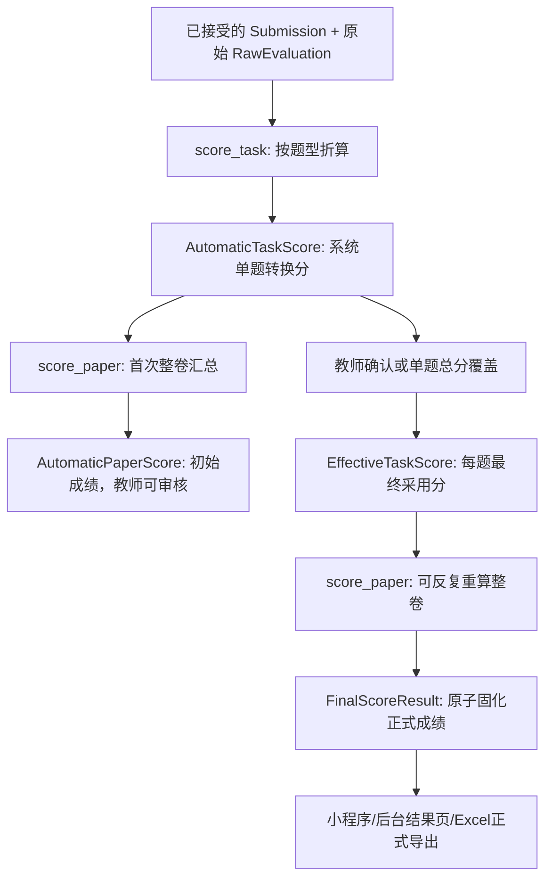

# VNext｜双阶段评分插件与教师复核专项设计 S1.0

> 日期：2026-11-12。状态：经会话确认的架构原则 + 待实现的接口建议；不是已实施代码。本稿更新并优先于 P1.1、R1.0 中“评分插件一次 calculate() 统一完成后不得再次运行”的旧表述，但不改变题库 T1.5、试卷 P1.1 和原始评价 R1.0 的其他业务决策。

## 0. 一句话合同【已确认】

**一套已部署的评分插件包含两块分工明确的代码：按题型进行“原始评价 → 单题转换分”的单题算法，以及接收已确定的各题分数进行“题型汇总 → 整卷总分 → 档位”的整卷算法。单题算法在原始评价准备完毕后执行并保存自动转换分；在此基础上先调用整卷算法得到初始系统成绩。教师仅确认或覆盖单题总分，不改原始分、LLM 维度分或转换算法。每次复核改变了已采用的单题分数，可以重新调用**同一个整卷算法**形成新的整卷结果；不因复核重新调用单题算法、LLM、ISE、ASR 或题型 Handler。**

## 1. 业务阶段与对外可见性【已确认】

1. 儿童的题型 Handler 只负责作答与可靠的 Submission；引擎适配器依据冻结题目和已接受的作答，存储 `RawEvaluation`（LLM／ISE／本地声学）及来源版本。儿童不会看到处理中间分。
2. 评分所需原始证据齐全后，进入 **初始评分计算阶段**。由所选 `ScoringPlugin.score_task()` 分别计算每道题，保存不可变系统转换分和相关计算依据。
3. `ScoringPlugin.score_paper()` **第一次执行**，读取全卷系统转换分，生成 `AutomaticPaperScore`（可作为教师复核时的系统建议成绩）；这不是未经确认就必须对儿童发布的正式成绩。
4. 教师复核界面可查看每道题的 `automatic_task_score`、理由和证据，并可**直接编辑该题总分**或确认原分；不要求逐维改分。每次改动形成 `ReviewDecision`，自动分保持不变。
5. 汇总引擎按每题最新合法复核决定形成 `effective_task_score`：有有效教师覆盖则用覆盖分；否则用系统自动分。它只是选取数字，不是调用单题算法。
6. 再运行已发布试卷绑定的 **同一个版本** `score_paper(effective_task_scores)`；可以随复核修改反复运行，以获得当前整卷总分与评级。必要复核流程完成后，将 `FinalScoreResult` 及其输入修订身份在单一事务中固化；儿童端、普通结果界面和正式导出只读取当前正式结果。
7. 如果已经正式发布的成绩之后获授权更正，需产生新的正式成绩修订，旧结果保留；不能静默覆盖已有正式结果。普通页面查询绝不运行计算插件。



**注意**：不是“两套不同的整卷算法”；初始自动成绩和教师复核后成绩使用 **同一插件版本中的同一个 `score_paper()` 实现**，区别只在输入是系统分还是复核后的采用分。

高级模式在本 Session 的合法访问范围内可展示 LLM 问题／引导、ASR、有效重听／求助事实、经筛选的原始评价维度和有限错误摘要；原始评价维度须标为**非正式诊断**，不等同自动分或正式成绩。未固化的自动单题分、自动初始整卷分及教师复核预览仅供授权教师后台查看；正式结果固化后，高级模式可查看最终成绩及详细组成。高级模式只是 UI 状态，不提供 M 参考答案、N 评分说明、完整内部 Prompt 或未经筛选的 RawEvaluation。

## 2. 最小插件接口【建议，非具体文件布局限制】

```python
from typing import Protocol

class ScoringPlugin(Protocol):
    plugin_id: str
    implementation_version: str

    def score_task(self, task_context, raw_evaluations, submission_facts):
        """纯计算：某题 RawEvaluation/作答事实 → 单题自动转换分与计算明细。"""
        ...

    def score_paper(self, paper_context, task_scores):
        """纯计算：已经确定的各题分数 → 题型汇总、整卷分数与档位。可重复调用。"""
        ...
```

- `score_task()` 既可通过 `task_type` 分发至内部五种题型实现，也可使用内部策略表；**不强加五个独立类或无意义的基类层级**。
- `score_paper()` 仅消费题目身份、顺序、题型、已采用单题分和插件算法实际需要的冻结试卷上下文；**不能暗中查询实时题库、重新评测录音、发起模型请求**。
- 允许不同插件使用不同题型分值上限、权重、归一化、舍入和档位处理。具体约束是插件自己的明示合同，不把旧版“十道题／固定五分制／某学段必有某题型”写死在平台基础层。
- 旧 `legacy_v1`、`trial_2026_v1` 可分别实现这两个接口；测试同一插件的 `score_paper()` 必须能用于系统自动输入和教师确认后的有效输入。
- 每次调用需要可追溯的 `plugin_id + implementation_version`；一旦已发布试卷引用这个版本，修改计算语义必须增加版本，不得原地改变。保留历史实现以供历史计算、故障恢复及经授权的更正。

## 3. 评分事实、系统分、复核分与采用分

| 概念 | 建议存放 | 谁产生 | 能否复核时改动 | 目的 |
|---|---|---|---|---|
| `RawEvaluation` | 来源独立的原始结果记录 | ISE/LLM/声学适配器 | **不改** | 保留真实原始评价及维度、量纲、版本 |
| `Submission` / `Turn` 等事实 | 作答领域 | 题型 Handler | **不改** | 重播、求助、选项、音频等实事 |
| `AutomaticTaskScore` | 自动评分结果集合 | `score_task()` | **不改** | 首次确定的系统单题转换分及公式明细 |
| `AutomaticPaperScore` | 初始整卷评分记录 | 首次 `score_paper()` | **不改** | 教师看到的机械初始成绩及其计算依据 |
| `ReviewDecision` | 复核事件／当前生效记录 | 教师 | 可创建后续修订，不覆盖历史 | 确认系统分或指定新的单题总分 |
| `EffectiveTaskScore` | 可作为确定性投影或结果快照 | 复核选择逻辑 | 随 ReviewDecision 更新 | 喂给 `score_paper()` 的最终采用分 |
| `FinalScoreResult` | 不可变正式结果修订 | 最新 `score_paper()` + 提交事务 | 需新修订，不覆盖 | 供儿童端、正式报表一致读取 |

单题采用规则：

```text
if effective_review_decision has teacher_override_score:
    effective_task_score = teacher_override_score
else:
    effective_task_score = automatic_task_score
```

- **教师确认原分**时不必复制一份相同数值到覆盖字段；记录“已确认”即可。复核过程不能把未填写覆盖分当成 0。
- 教师覆盖分须符合**当前已选插件对该题允许的分数范围／数值合同**，不可擅自套用全平台固定 0～5。
- 复核理由是否必填、哪些题必须复核、已确认后是否允许再次修改等属于未来复核流程 UX/权限决策；不要偷加与当前需求无关的限制。
- 若某题自动分缺失，**不能仅以 `N/A` 绕过评分和人工确认**，应按评测失败流程处理。是否授权教师以人工分完全替代缺失的自动分，需要另行批准，不在本稿默认引入。

## 4. 初始总分与复核重算：一套算法，两类输入【已确认】

例子：假设试卷含三道题，评分插件采用一个示例的非等权聚合（仅说明语义，不代表实际规则）：

| 题目 | 自动转换分 | 教师覆盖分 | 最终采用分 |
|---|---:|---:|---:|
| 选择题 A | 5.00 | 未覆盖 | 5.00 |
| 跟读题 B | 4.00 | 未覆盖 | 4.00 |
| 说话题 C | 3.75 | 4.50 | 4.50 |

1. `score_paper([5.00, 4.00, 3.75])` → 初始总分和档位（冻结到 `AutomaticPaperScore`）。
2. 教师仅把 C 的该题总分改为 4.50。**不调用 `score_task(C)`**。
3. `score_paper([5.00, 4.00, 4.50])` → 新的整卷总分和档位（可作为复核预览或新 `FinalScoreResult`）。
4. 不能将“单题增加 0.75”直接加到整卷成绩上，因为算法可能包含不同权重、内部归一化或非线性规则。
5. 教师后续若再次修改 C，依然只重算 `score_paper`；相同输入必须得到相同输出，不应产生重复扣分或叠加计算误差。

## 5. 异常处理、N/A 与结果展示【已确认原则】

- `RawEvaluation` 有真实 0 与 `PENDING/FAILED/INVALID/UNAVAILABLE` 的区别。单题计算缺必要输入时保存明确状态，不编造 `automatic_task_score=0`。
- 必要单题转换分尚未就绪时不能伪造完整初始总分；正式整卷成绩不得进入 `READY`。
- 当前系统不可计算正式成绩时，**普通用户只看到“成绩生成中”或“成绩暂不可用”**，不暴露中间分。教师诊断页面可看到具体失败项并显示 `N/A`。
- `AutomaticPaperScore` 可以在教师复核后台显示，但与正式成绩标记明确区分；不能误导儿童认为它是确认后的成绩。
- 已经固化的 `FinalScoreResult` 不因访问页面、刷新页面、重载服务自动重算。

## 6. 事务、一致性、重试与历史【建议】

- 首轮自动评分作业以某组已确定 `Submission`/`RawEvaluation` 的身份为输入。`score_task` 幂等地记录自动结果；失败重试不能在一份结果中混合不同输入来源。
- `score_paper` 是无外部调用的纯计算，可即时按需重复执行。UI 发出的教师复核提交先校验评分版本与该次复核修订，随后在同一事务中保存复核决定和对应整卷结果/版本，避免“单题分已改但总分仍是旧值”的半提交。
- 为避免教师 A/B 同时保存导致后保存者覆写先保存者的复核，提交时核验最近复核修订／乐观锁；这是必要的一致性规则，不额外规定业务上不允许多次修改。
- 正式成绩修订记录保存它采用的 `review_revision` 和评分插件版本，可追溯初始成绩与人工调整的差异。
- 若新一轮作答已取代旧的已接受 Submission，先前自动评分和复核针对旧 Submission 的结果不可作为新 Attempt 的当前正式成绩。新输入由新评分流程产生，不能把旧分直接沿用。

## 7. 验收测试（必须能自动证明）

1. 同一批 RawEvaluation 执行单题评分产生稳定 `AutomaticTaskScore`；初始整卷算法读自动分产生 `AutomaticPaperScore`。
2. 复核确认原分时，采用分等于自动分，重算整卷分与初始自动整卷分一致。
3. 教师只覆盖某题总分，其余题不动；整卷总分和档位按插件重新计算。
4. 复核覆盖后再修改同题，不重复调用单题算法，不重复扣重播/求助分。
5. 带非线性或非等权汇总的插件证明不可用“新旧单题差值加到总分”代替 `score_paper()`。
6. 一次教师复核操作写入失败时，复核决定与对应整卷结果整体回滚；不允许一半新一半旧。
7. 任一必要原始评分失败时显示 N/A/失败状态，不产生完整自动分或正式分，不能补默认 0。
8. 原始分真实是 0 时能够计算并展示真实 0，不等同缺失。
9. 小程序结果页、教师正式成绩页面及 Excel 正式报表均只读数据库中已固化的 `FinalScoreResult`，不调用插件。
10. 试卷绑定的旧 `implementation_version` 在新插件部署后仍被调用；不会静默换新版本。
11. 从旧试卷完整复制得到的新草稿保留原评分算法版本，与题目版本继承语义一致。
12. 已发布正式成绩的合法更正产生新结果修订，旧成绩和复核历史仍可追溯。
13. 若旧 Submission 已被新的有效作答取代，旧分不可被错误当作当前自动分或复核覆盖分。
14. 两个教师并发复核时不产生“单题采用分与整卷分不匹配”的正式结果。

## 8. 与其他设计文档的关系

- **替换 P1.1 §8** 的单一 `calculate(context)` 示意为 `score_task(...)` 与 `score_paper(...)` 两方法分工；§9 中“单题有效分”的计算时点改为：先计算并保存系统自动转换分，复核决定最终采用分，整卷再算。
- **替换 R1.0 §1 第 3～4 条** 的“只有一次统一执行插件”的歧义：**首次成绩处理阶段包括单题评分 + 首次整卷评分；复核期间可多次调用整卷评分；普通用户只看到最终固化版本**。
- **保留 P1.1** 的题库最新版本选题、完整复制旧卷、归档语义、无在线公式配置／热更新、发布冻结插件实现版本。
- **保留 R1.0** 的讯飞固定输出协议、LLM 系统级评分 JSON 合同、题目级评分说明作为 LLM 上下文、真实 0 与 N/A 的区别。

## 9. 仍需后续讨论的边界，不擅自确定

1. 复核是全部题目都必须教师点击确认，还是只要求系统／抽样指定的题目确认？本稿只规定被复核的单题可以改总分。
2. 是否允许教师在**自动评分失败时**手动给一个单题分作为兜底？本稿不自动允许，须另行定业务责任。
3. 成绩在“复核尚未完成”期间是否允许教师下载标明未完成的诊断预览？本稿只规定普通用户不看到中间成绩。

> 设计目的：**保持单题转换只依赖原始评价与冻结作答事实、整卷汇总只依赖已确定的单题分；复核只改变单题采用分，然后重新汇总。**
