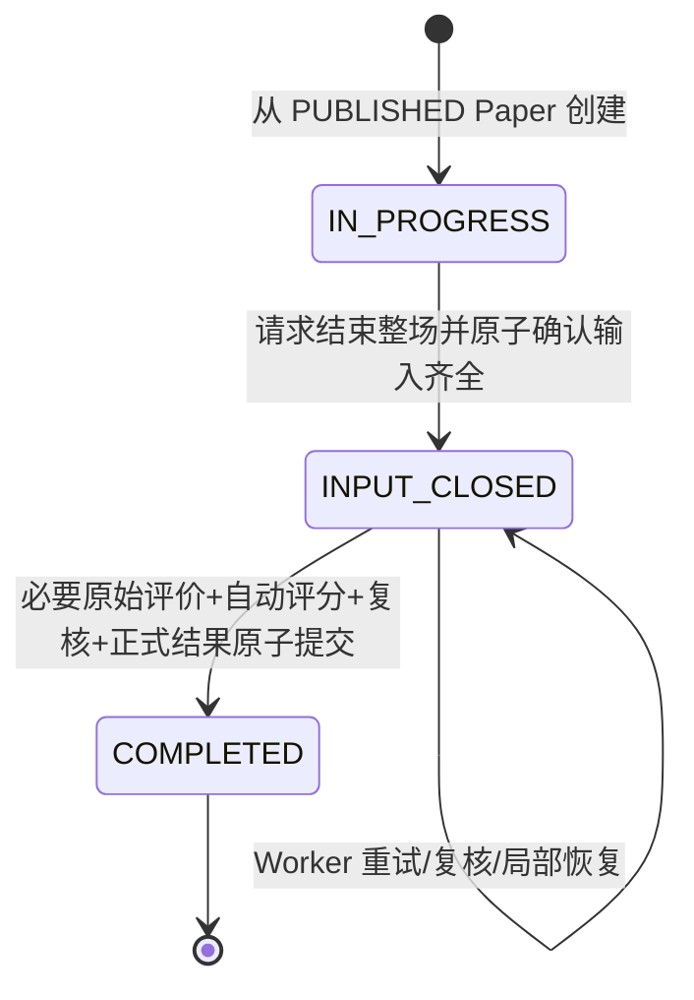
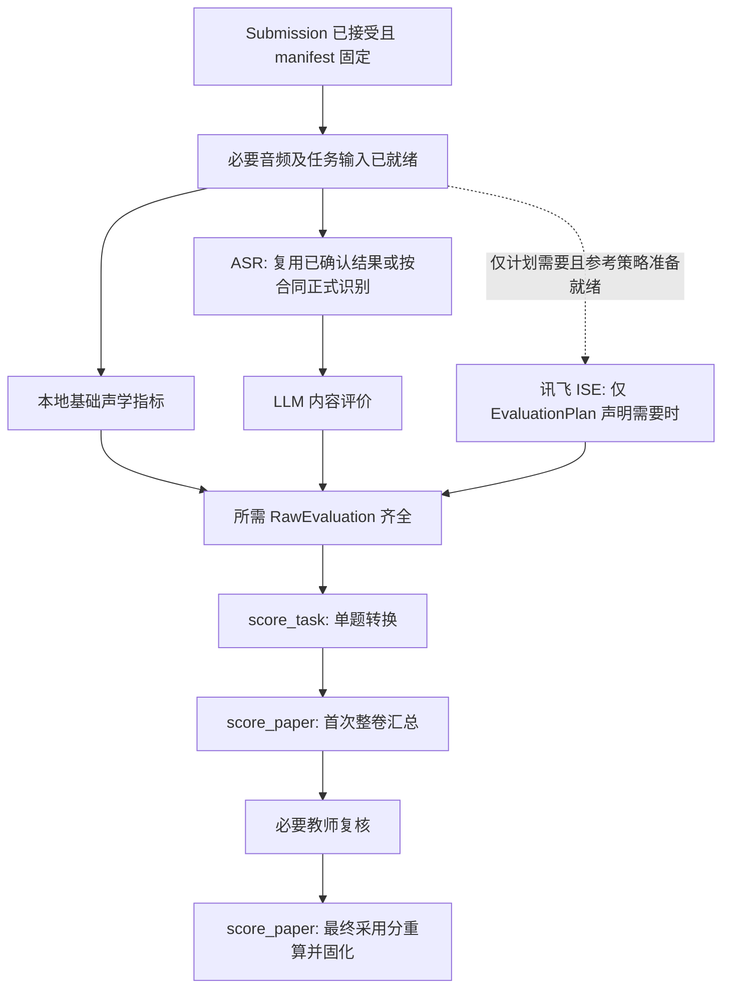

# VNext｜Session 生命周期、Submission 候选冻结与后台 Worker 调度专项设计 SW1.1

> 日期：2026-11-13<br>
> 状态：**SW1.1 收敛修订版**。本版正式确认显式重做语义、关闭后不可撤回、按需人工复核三项业务规则；技术细节仍以【建议】标记，未定业务边界明确留待后续。本稿不授权修改代码、数据库、服务器或旧仓库。<br>
> 参考：`AGENTS.md`、`VNEXT_INITIAL_ARCHITECTURE_DESIGN.md`、Speaking v1.1、Dialogue v1.0、题库 T1.5、试卷 P1.1、原始评价 R1.0、评分 S1.0、按需评价 E1.0。<br>
> 仓库：新 `ZhongYun999/preschool-mandarin-assessment-rebuild`；旧 `ZhongYun999/preschool-mandarin-assessment` 仅做只读行为审计。

## 0. 本专项要解决什么

将一场测评的**输入阶段**、已经提交的**不可变作答**、**按需原始评价**、**双阶段评分**、**教师复核**、**正式结果发布**分离；既允许儿童提交题目后立即进入下一题，又避免 Worker 抢先读取尚未准备好的材料、重复扣分、丢失录音、误结算、偷偷调用未声明的 ISE。

总原则：**Session 管测评生命周期；题型 Handler 管作答；Submission 管被接受的固定输入；EvaluationOrchestrator / Worker 处理技术工作；ScoringPlugin 管数学计算；教师复核决定单题采用分；ScoreResult 是唯一正式成绩来源。**

## 1. 已经确认的边界【继承既定】

1. 正式 Session 只能从发布时冻结了题目版本、题序、评分插件版本与评价来源需求的 `PUBLISHED Paper` 创建。已归档 Paper 不再进入新建选卷入口，已经存在的 Session 不受归档影响。
2. `SessionTask` 轻量绑定 `PaperEntry`，不复制第二份完整题目快照；每道题由自己注册的 Handler 管 Attempt 状态机。
3. Speaking：音频先保存、必要 ASR 后确认；儿童主动求助与重播独立计数；达到当前业务时长资格后儿童主动结束；正式 Submission 被接受后即放行下一题。后台技术失败不要求重录。
4. Dialogue：每轮 Q/P/A/B/T 可靠断点与严格轮次控制；目标轮数属于冻结的题目版本；全部轮次达标后儿童主动结束本题；正式 Submission 被接受后即放行下一题。
5. `Submission` 接收、关联 manifest、封存 Attempt、让异步处理可见，必须同一个数据库提交边界。录音存储或临时引导不等于正式 Submission。
6. `RawEvaluation` 保留 LLM/ISE/本地声学原始指标与引擎/合同版本；不提前折算五分制或执行重听、求助扣分。
7. 每套评分插件声明按题型所需评价来源；不在冻结需求里的开放题 ISE **不创建任务、不调用、不重试**。ASR 与 ISE 区分。
8. 同一插件包含 `score_task()`（原始证据→自动单题分）与 `score_paper()`（已确定单题分→整卷分及档位）。教师只覆盖单题采用分，复核后只重跑整卷方法。
9. 未完成或失败的必要评价不是“0 分”。无可靠完整结果时普通儿童端不提供中间分；正式结果原子固化，查询、导出和统计不重算。
10. 运行中未完成 Attempt 的题型业务资格按**当前题型运行政策**判断，试卷发布时确定的题目内容和评分合同不随配置更新。
11. 【本版确认】显式整题重做之后，原 A Submission 立即退出当前候选。新 B 若未正式提交则本题未完成，Session 不得关闭。
12. 【本版确认】`INPUT_CLOSED` 关闭请求一旦成功，不提供特殊撤回、恢复作答或重新选择 Submission 的业务路径；后台故障仅恢复处理。数据库管理员在系统外处理数据删除不属于业务 API。
13. 【本版确认】人工复核只覆盖复核策略命中的题目。其余题目直接采用系统自动转换分；命中项必须确认后才固化最终成绩。

## 2. 三种不同的“完成”——不要用一个 completed 字段包办【建议】

| 完成事件 | 业务含义 | 谁裁决 | 是否可进入下一题 |
|---|---|---|---|
| `SubmissionAccepted` | 某题当前 Attempt 满足题型资格，固定提交输入 | 题型 Handler + Submission 事务 | **可以** |
| `RawEvaluationReady` | 该提交对应的必要来源返回并验证，原始证据完整 | EvaluationOrchestrator | 与儿童导航无关 |
| `FinalScorePublished` | 全卷有效输入选定、自动分、必要复核、整卷重算全部完成并落库 | Session 结算协调服务 | 已是正式成绩 |

不要把 `SessionTask.completed`、`record.confirmed`、`session.completed` 当同一种真相。显示层的“已做完本题”与“已得到分数”是两类进度。

## 3. Session 最小业务状态机【建议】

用尽量少的**权威业务状态**，后台进度通过作业与实际证据投影：



- `IN_PROGRESS`：允许进入题目、保存 Attempt 断点、按各题型合同正式提交、以及业务允许的显式整题重做；**不提供正式总分**。
- `INPUT_CLOSED`：已经冻结本场纳入结算的 Submission 集合。可以等待、恢复后台作业、教师复核，但不得让普通作答再改变这个结算输入；**不等于评分完成**。
- `COMPLETED`：在创建不可变 `FinalScoreResult` 的同一事务中设置。对外只读已固化成绩。
- 第一版不引入 `REOPENED`、`WITHDRAWN` 或“撤回结算”状态：关闭后的作答输入不得在业务流程中重开。其他未讨论的状态（如行政更正）仍不提前设计。
- 将 `WAITING_EVALUATION`、`SCORING`、`WAITING_REVIEW`、`REPAIR_REQUIRED` 视为根据后台作业／复核事实计算的**处理阶段投影**，不额外维护五份相互竞争的 Session 权威枚举。需要数据库缓存时只能由一处投影服务更新。

### 3.1 处理阶段投影（不是独立业务状态）

| 展示投影 | 判定基础 | 儿童/普通结果端 | 教师诊断端 |
|---|---|---|---|
| `answering` | `IN_PROGRESS` | 当前题目及进度 | 作答进度 |
| `waiting_evaluation` | 已关闭输入且必要 `EvaluationJob` 尚未齐 | 成绩生成中 | 来源、排队与等待项 |
| `evaluation_problem` | 必要来源失败/无效/执行结果不明 | 成绩暂不可用 | `N/A` 和错误、重试入口 |
| `automatic_ready` | 所有选定题目自动分与首次整卷分已保存 | 成绩生成中/待确认 | 系统单题分和初始总分 |
| `awaiting_review` | 有必须处理的复核项 | 成绩待确认 | 复核操作 |
| `completed` | `COMPLETED` 且正式结果已持久化 | 正式总分与档位 | 正式结果及其修订 |

## 4. Session 创建与选择题目【建议】

- 创建请求只允许指向当时可创建 Session 的 `PUBLISHED Paper`；检查必要题目、发布资源和插件版本能被运行时识别。已经建立的 Session 不因 Paper 后来归档而失效。
- 一次事务建立 Session 与其全体 `SessionTask(PaperEntryRef)`；返回确定的顺序和服务端进度投影。启动某一道题并不提前新建所有题目的 Attempt。
- 对同一业务创建动作使用稳定 `create_request_id` 幂等防双击；同请求重传返回原 Session，不因为前端刷新生成第二场。
- 不在 Session 创建时复制一套动态 LLM 提示词或题目文本；读取固定 PaperEntry 的 TaskRevision。固定 LLM 评分说明、模型输出合同以及 EvaluationPlan 版本参照发布时记录。

## 5. Attempt、Submission 与整场有效输入选择

### 5.1 单题当前作答入口【继承既定 + 建议】

- 一个 `SessionTask` 在正常交互中只有一个当前可操作 Attempt；新 Attempt 只能由明确的业务事件创建，刷新页面不创建。
- `OPEN → SEALED` 是被接受的 Submission；`OPEN → ABANDONED` 是显式重做；`SEALED` 后重做不抹掉旧提交，旧候选被 `SUPERSEDED`。
- 后台作业始终关联实际 `submission_id`；已经 superseded 的 Submission 仍可保存历史证据，但**绝不被重新提升为当前成绩候选**。

### 5.2 历史设计冲突已裁决【本版确认】

总体架构早期文档有一条示例：“已有效提交 A，创建 B 但 B 未提交时，仍可能采用 A”。但较新的 Speaking v1.1 与 Dialogue v1.0 明确规定：**用户显式重做后，旧 A 已 SUPERSEDED，不可因新 B 未完成而偷偷恢复计分**。

本专项**正式采用**较新的显式重做语义：

1. 还没有点击“整题重做”：已接受的 A 仍是本题当前候选。
2. 明确点击重做并成功建立 B：A 已退出候选；B 如果没有成功提交，该题**目前没有结算候选**，整场结算请求应被拒绝并指出该题未完成。
3. B 正式提交成功后成为当前候选；旧 A 只保留审计资料。**不靠取最大数据库 ID 猜测有效候选**。

在后续文档整合时必须修订总体架构 §5.3 的过时示例，旧 A 不允许因 B 未提交而自动兜底；这已是确定业务规则，不再由开发者自行选择。

## 6. 整场“结束测评”：原子冻结输入集合【建议】

儿童在最后一道题后点击“结束整场测评”，发出稳定 `close_request_id`。这与题目里的“结束本题”是两件不同的动作。

**单一事务顺序（逻辑合同）**：

1. 锁定或条件更新该 Session 的权威行，确认当前为 `IN_PROGRESS`，请求者可操作，且没有并发的整题重做或结束题目事务。
2. 检查每个 `SessionTask` 当前候选：必须有一份该题 Handler 已合法接受、Attempt 已 `SEALED` 的完整 Submission。不能拿尚在录音、引导、ASR 或仅有音频的 Attempt 代替。
3. 固定有序 `CloseManifest`：每个 PaperEntry 对应的唯一 `submission_id`、Attempt 身份及本场结算输入版本/摘要。它是**已保存 ID 引用列表**，不是复制音频或题干。
4. `IN_PROGRESS → INPUT_CLOSED`，保存一次关闭操作身份、冻结输入标识及结算调度身份；整个事务提交成功后后台才可读取。
5. 返回“作答已提交，成绩生成中”，不等待外部 LLM/ISE、单题转换分或教师复核。

- 如果某题没有合法 Submission，返回未完成的题目身份，保持 `IN_PROGRESS`；不凭空补零或强行封卷。
- 同一关闭请求重传返回同一个 CloseManifest；已关闭 Session 再请求不创建另一套结算输入。
- 新旧 Attempt 的竞争与结束整场的竞争必须使用相容的数据库裁决/锁顺序；不能某事务认定 A 有效，另一事务同时用 B 替代 A，却仍然结算旧的 A。
- 【本版确认】`INPUT_CLOSED` 后**绝不提供业务撤回或重新开放作答**：无论评分中、评分失败或待人工复核，现有 `CloseManifest` 都保持不变。若数据库由管理员在系统外紧急维护，不视为合法的 Session 状态转换。

## 7. 后台作业：按真正的输入依赖创建 DAG【建议】

**不要让“总 Record 进入 queued”代表其所有子资源已经可用于处理。** 同一提交可能包含逐轮音频、片段 ASR、合并音频等不同来源。由每个作业显式声明上游依赖：



上图是某类开放题的**组合能力图**，实际只执行冻结计划要求的节点；如果某插件没有声明 `local_acoustic`，它也不会作为必要节点；如果无需 LLM，跳过相关 ASR 及 LLM 评分节点。Speaking/Dialogue **作答中为了推进和引导而需要的 ASR、TTS/LLM 调用**属于题型状态机工作，不因为评分插件没要求“评分 ASR”就省略。

### 7.1 生成和调用的时机

- **最低必需**：Submission 接受成功后，按冻结的 `EvaluationPlan` 生成必要评价工作的持久身份；准备好的来源可异步执行，不阻塞儿童进行下一题。
- **成本优化**：领取需要付费的评价工作前，再确认该 Submission 是否仍为当前可计分候选；若已明确被重做替代且尚未发起外部调用，可跳过或取消未开始的工作。已经发出的外部调用可能无法撤回，不承诺消除全部重做成本。
- `INPUT_CLOSED` 后只对 CloseManifest 固定的 Submission 集合进入**正式自动评分批次**：在所有必需 RawEvaluation 就绪时才运行各题 `score_task()` 与初次 `score_paper()`。这样不因孩子刷新、页面查看或以前作废的提交重复计算单题分。
- 未来若业务要求“只在整场结束后才调用所有付费评测”，可改变**评测任务启动政策**，而不是修改题型状态机、原始评价合同或评分插件接口；第一版不无依据强行采取这一延迟策略。【建议】

### 7.2 按需 ISE 的严格规则【继承既定】

- 若冻结计划不包含 `iflytek_ise`：该 Submission 的该种 ISE `EvaluationJob` 记录数必须为 **0**，供应商请求数也为 **0**，包括正常执行、扫描补偿、重复提交、Worker 重启和重试。
- 若冻结计划明确需要 ISE，必须先满足对应评测合同的类别、参考文本可信来源和音频粒度。开放题不能默认使用“ASR 文本即标准朗读文本”。
- 某来源未被要求而没有 RawEvaluation 是 **正常不存在**，不是 `FAILED` 或 `N/A`。
- 插件仅使用已保存并成功验证的 RawEvaluation；**评分插件绝不发外部调用**。

## 8. Worker 的最小可靠作业合同【建议】

| 概念字段 | 含义与理由 |
|---|---|
| `job_id` | 持久技术工作身份，避免进程内队列丢失 |
| `submission_id` + `source_contract` | 指向被接受的提交和所需评价协议 |
| `input_fingerprint` | 固定音频、文本、题目评分说明、参考策略等实际输入身份，防止同一工作用错输入 |
| `dependencies` | 必要上游工作或已保存事实关联，保证可执行前置条件 |
| `status` | 至少能够区分排队、执行、成功、失败/待重试、取消/跳过 |
| `claim_token`/租约与到期时间 | 防止两个 Worker 把同一结果同时宣布为权威；宕机后可恢复 |
| `attempt_count`/`next_retry_at`/`error_code` | 自动技术重试预算与分类诊断；不是儿童 Attempt 次数 |
| `result_ref` | 成功的 RawEvaluation 或可核对的原始输出引用 |

**基本算法**：

1. 接收 Submission 的提交事务中写入可靠工作意图（例如数据库作业/事务 outbox）；不得“提交成功后靠一次进程内通知”作为唯一启动信号。
2. Dispatcher 找到**所需依赖已满足**的作业，以数据库条件更新和短租约领取；长期服务商调用不持有业务数据库事务。
3. Worker 调用相应适配器，验证响应合同，将结果及来源、版本、返回数据和调用日志保存；写入时比较仍有效的作业 `claim_token`/输入身份，防止过期 Worker 覆盖新执行。
4. 恢复器扫描过期租约和可重试失败，恢复**同一作业的技术执行**，不创建新的儿童 Attempt 或 Submission，也不清空已经成功保存的事实。
5. 扫描和任务推进以可持久化状态与依赖为准；Worker 或服务器重启后无须依赖进程内列表还原业务。
6. 对付费来源建立独立额度/请求计数：按插件、任务类型、source_contract、真实提交身份统计；不得在日志打印任何 API 密钥、儿童音频或全部对话内容。

### 8.1 “恰好一次调用”不能无条件承诺

本地数据库可以做到**同一成功 RawEvaluation 不重复正式入库**，但若供应商已经收到请求并扣费、Worker 却在保存成功结果前断电，服务器无法单凭本地数据库判断外部是否成功执行。

所以：
- **逻辑幂等/去重**：同一冻结 Submission + 相同来源合同与输入摘要，成功评价直接复用；不因页面刷新重新调用。
- **有供应商请求幂等键或查单能力时**：优先使用其能力恢复。
- **供应商没有此能力且结果不明时**：记录“外部结果未知/可能已计费”的诊断事实，明确有限重试策略及潜在重复费用；不能虚假宣传所有宕机情形绝不会重复付费。可让维护者在确实有必要时发起受控重试。
- 自动重试预算由具体技术故障类型、运营策略和成本确定，不写入通用业务规则的固定次数上限。

## 9. 自动评分批次与按需教师复核【已确认业务原则 + 技术建议】

1. `CloseManifest` 指定**唯一的一组**有效 Submission，称为 `scoring_input_revision`（或等价输入摘要）。
2. 仅对当前输入组依赖的必要评价全部成功/合法的题目运行 `score_task()`；保存每题系统自动分、插件版本及实际引用的 RawEvaluation ID。对于失败项只保留错误状态，不产生貌似完整的总分。
3. **全题系统转换分**齐全后，对整卷运行同版本 `score_paper()`，保存 `AutomaticPaperScore`，作为教师可见的系统初始成绩。
4. 自动分齐全后，根据**Session 创建时冻结的复核策略**和评测完成后真实存在的模型复核建议，为本次 `CloseManifest` 中每道题确定并持久化复核决定。未命中者自动接受系统转换分；命中者进入教师复核队列。教师只可确认原分或给出覆盖单题分，不修改原始评价与系统转换分。不同输入快照之间不继承复核决定。
5. 每次教师修改有效单题分后，重新运行同版本 `score_paper()`，保存可追踪的汇总修订；**不运行 `score_task()`、ASR、ISE 或 LLM**。教师不修改的题继续使用系统分。
6. 所有**必需**复核完成且版本仍匹配时，单一事务插入不可变 `FinalScoreResult`（带输入摘要、评分版本、有效单题分/计算依据和复核修订），并将 Session 改为 `COMPLETED`。
7. 用户查询、教师正式统计与 Excel 正式导出只读当前已固化的结果记录；自动初始成绩与错误详情仅在教师评分/诊断区域出现。

注意：即便初始自动整卷分已就绪，`INPUT_CLOSED` 仍未必是 `COMPLETED`。若此次**全部题目都没有命中复核**，在评分证据齐备后直接原子固化正式结果；若存在命中项，只等待这些命中项完成，不需要其他题目由教师逐一点击确认。

高级模式在本 Session 的合法访问范围内可展示 LLM 问题／引导、ASR、有效重听／求助事实、经筛选的原始评价维度和有限错误摘要；原始评价维度须标为**非正式诊断**，不等同自动分或正式成绩。未固化的自动单题分、自动初始整卷分及教师复核预览仅供授权教师后台查看；正式结果固化后，高级模式可查看最终成绩及详细组成。高级模式只是 UI 状态，不提供 M 参考答案、N 评分说明、完整内部 Prompt 或未经筛选的 RawEvaluation。

### 9.1 按需复核策略与抽样机制【本版确认 + 复用旧机制建议】

从旧仓库 `backend/app/services/review_policy_service.py`（main 分支只读审计）确认：旧系统拥有 `default_ratio`、按题型 `task_type_ratios` 和单题 `task_ratio_overrides`；创建 Session 时会保存策略快照。旧版默认图片选择／指令题 0%，跟读／问答／对话／说话 100%。这组旧**默认数值不强制搬入** VNext，配置接口及策略语义可以借鉴。

| 策略层次 | 作用 | 建议优先级 |
|---|---|---|
| Session 中单题覆盖 | 对当前具体题单独设定抽样比例 | 最高 |
| Session 中按题型配置 | 如仅问答 20%、跟读 30% | 其次 |
| Session 的默认比例 | 未设覆盖时的基础抽样率 | 最后 |

- 策略可以由教师／管理员设置；**已创建 Session 的策略快照不被之后全局设置变动追改**。仅保存实际用于复核决策的规则，不为 UI 另设无用描述字段。
- 抽样是按稳定身份的确定性选择，建议以 `session_id + session_task_id` 等**稳定业务身份**生成桶值；不能因客户端刷新、Worker 重试、Attempt 技术重建而改变抽样命中情况。不能用“每刷新一次随机抽取”决定结果。
- 旧版明确采用 `model_need_teacher_review OR sampled`：即**模型显式建议复核**与**比例抽样**分别触发。VNext 建议保留：抽样设为 0% 表示不作常规抽样，**不自动屏蔽模型明确提出的复核建议**。是否允许另设禁用模型强制复核的政策属于以后真实需求，不在此提前增加开关。
- 模型建议只是评价源提供的事实/提示，不由 LLM 直接写数据库权威复核状态；由服务端在原始评价可用后按冻结策略裁决。没有 LLM 评分的题目仍可被抽样。
- 同一题的复核决定一旦针对选定 Submission 固化，单纯页面读取或后台重试不重新抽签；复核记录带 `session_task_ref`、`submission_ref`、`input_revision` 与选择原因，例如 `sampled` 或 `model_flagged`。
- **技术失败与需要复核不同**：必需原始评价未得到时应进入 FAILED/INVALID 与后台重试，而不是用人工复核标记掩盖未计算的自动分。系统初始分已就绪后，教师只处理命中项。

### 9.2 复核与整卷结果固化时机【本版确认】

| 场景 | 处理动作 | 最终结果 |
|---|---|---|
| 所有必要原始评价及自动单题分就绪；复核命中 0 题 | 首次 `score_paper()` 已生成自动整卷分，直接在原子事务中固化正式结果 | `COMPLETED` |
| 命中若干题；教师还未全部处理 | 初始自动整卷成绩只供教师评分后台查看；儿童不见半成品分 | 保持 `INPUT_CLOSED` |
| 教师确认某命中题自动分 | 有效采用分等于 `automatic_task_score`，保存确认事实 | 继续等待其他命中项 |
| 教师覆盖某命中题分数 | 保存教师分与复核修订，以当前有效单题分重跑 `score_paper()`，不调用 `score_task()`、ISE 或 LLM | 更新教师侧整卷预览 |
| 全部命中项完成 | 以当前有效单题分运行/确认最终 `score_paper()` 结果，`FinalScoreResult` 与 Session `COMPLETED` 原子持久化 | 儿童可见正式成绩 |
| 已关闭 Session 尝试撤回结算或继续录音 | 业务 API 拒绝，不改变 `CloseManifest` | 无状态回退 |

**约束**：初始自动成绩、教师侧复核预览与儿童端正式成绩是不同数据可见性级别；所有公开成绩均来自已持久化的 `FinalScoreResult`，绝不从当前页面状态实时换算。

## 10. 并发、旧结果迟到与事务防线【建议】

| 冲突/故障 | 必须保证 |
|---|---|
| 同一正式提交网络重发 | 返回同一 Submission，不能创建重复后台付费工作 |
| 音频已保存、ASR 技术失败 | 恢复同一音频/操作，不能让孩子重新录制才可以继续 |
| Worker 抢在输入齐备前领取 | 依赖未就绪的 Job **不可执行**，不能先读取“猜测的合并 WAV” |
| 两个 Worker 同时领取 | 数据库 CAS/租约裁决；过期执行不能覆盖有效结果 |
| A 已提交，儿童明确重做 B | A 可保留历史 RawEvaluation，不再作为最新候选；B 未提交前不可结算 |
| 重做请求与关闭整场同时到达 | 原子决出先后；不会冻结 A 后同时将其标为失效 |
| Worker 在旧 A 上返回较晚 | 只能更新属于 A 的历史评价，不能使当前 Session 变更候选或成绩 |
| 关闭整场重复请求 | 返回同一 CloseManifest，只有一组正式输入 |
| 必需 ISE 被插件省略 | 不得调用 ISE，也不应报“缺少 ISE 分数” |
| 必需 LLM/ISE 失败或返回非法结构 | `FAILED/INVALID`，普通用户看“成绩暂不可用”，教师看到来源级 N/A；不能隐式设 0 |
| 教师修改复核与另一个教师同时提交 | 核对输入及 Review 修订，不能使“单题已更新、整卷仍是旧总分” |
| `FinalScoreResult` 落库时崩溃 | Session 状态与结果原子提交，不能一边 completed 一边缺结果 |
| 已完成后用户反复刷新 | 只读当前固化结果，不调用评分插件、不创建新工作 |

## 11. 数据模型最小草案【建议，不强制一对象一张表】

```text
Paper(PUBLISHED) -- PaperEntry(frozen TaskRevision + EvaluationPlan)
  └── Session(id, child_id, paper_id, lifecycle, close_request_id?, closed_at?, final_result_ref?)
       ├── SessionTask(id, paper_entry_id)                         # 不复制完整题目
       │    └── Attempt(id, lifecycle, candidate_disposition)     # 题型各自状态
       │         └── Submission(id, manifest_digest, accepted_at)
       │              ├── EvaluationJob(id, source_contract, input_fingerprint, ...)
       │              └── RawEvaluation(id, source_contract, source_version, metrics, ...)
       ├── CloseManifest(id, input_revision, ordered_submission_refs)
       ├── AutomaticTaskScore(submission_ref, input_revision, plugin_version, ...)
       ├── AutomaticPaperScore(input_revision, plugin_version, ...)
       ├── ReviewDecision(task_ref, submission_ref, revision, override_score?)
       └── FinalScoreResult(input_revision, plugin_version, review_revision, result_payload)
```

- 这是**业务身份图**，不是必须按图建表。`Job` 与复核修订可按实际数据库实现分拆或合并，只要避免互相竞争的权威值。
- 尽量以不可变实体引用和真实事实导出进度，避免 `SessionTask.completed=true`、`AssessmentRecord.status=confirmed`、`SessionStatus.ready=true` 三个各写各的状态。
- 出于儿童隐私与数据保存需要，RawEvaluation 的服务商原始响应与音频资源应分层权限/保存；外部日志不能默认打印完整文本、儿童个人资料或凭据。

## 12. API 与小程序契约最小要求【建议】

- Session 创建：稳定创建请求 ID，返回 `session_id` 与绑定的 `paper_id`，不由客户端拼装题目版本。
- Session 进度查询：返回题目顺序、当前候选 Submission / Attempt、题型页面的状态入口、整体可执行动作 `allowed_actions`；状态仅依据服务端持久化事实。
- Session 关闭：幂等 `close_request_id`，成功返回“结算输入已接收”与进度查询地址；若不齐则返回具体缺哪道题。
- Session 状态查询：为普通端仅输出 `answering / preparing_result / result_unavailable / result_ready` 等可理解投影和已固化结果入口；无分项中间评分。
- 教师评价诊断：允许查看某个 Submission 的来源级处理进展与错误码、是否真的调了 ISE、复核与自动初始分；权限与儿童结果接口分离。
- 小程序切换题型、断网恢复、child/advanced UI 模式切换**不**重新创建 Session/Attempt/Submission，不自行增加重播或求助计数，不假设上一次页面缓存就是权威状态。

## 13. 建议的自动化验收案例（第一组 36 项）

**Session 与候选（1–9）**
1. `PUBLISHED` Paper 可以创建 Session，`ARCHIVED` 不进入普通新建；归档后已有 Session 能继续完成。
2. Session 创建请求网络重发只创建一场；不同真实请求可正常创建独立场次。
3. 各题目首次进入只创建属于本题的 Attempt；刷新、切换模式不创建新实例。
4. Speaking 和 Dialogue 的 Submission 接收成功立即进入下一题，即使后台评分尚未开始。
5. 只有已保存录音、没有正式 Submission 的题目，不能通过整场关闭。
6. 已提交 A，显式重做 B 未提交时结算不接受 A 作为隐性兜底（已正式确认）。
7. 关闭整场与重做并发，只存在一个符合数据库裁决的候选集合。
8. 关闭请求重复发送，同一 CloseManifest；不会重复入队全场评分作业。
9. `INPUT_CLOSED` 后后台失败不重新打开儿童作答，也不丢失原 Submission。

**作业依赖、费用与恢复（10–20）**
10. 仅有原录音，没有 Dialogue 必需逐轮来源时，评分下游 Job 不可领取；所有上游确认后才解锁。
11. Speaking 多段音频需满足当前评价合同所需的真实素材；不提前拿“临时已合并文件”当作所有输入就绪。
12. 同一 Submission 同一 source_contract 反复扫描，只生成一组作业身份。
13. 评分插件 A 未要求 QA/Dialogue/Speaking ISE：正常、失败重试、后台重启后，三类开放题 ISE 任务数/请求数始终为 0。
14. 插件 B 只要求 QA ISE：仅 QA 创建 ISE Job，不能顺带调用其它开放题 ISE。
15. 不需要某项来源时，该来源无 RawEvaluation 不构成缺失错误。
16. ISE 返回明确的零分与未返回字段、服务错误区别处理。
17. Worker 在上游结果持久化前崩溃，重启后按已确认断点重新推进，不要求儿童重录。
18. Worker 在外部接口调用后、本地落库前崩溃，记录调用结果未知风险；不能伪造“恰好一次收费”。
19. 两个 Worker 或旧租约同时返回，只有有效持有者/任务修订可提交权威结果。
20. 被重做替代的历史 Submission 的迟到评价不进入本场当前成绩；若请求尚未发出可安全跳过付费工作。

**评分、复核、结果（21–36）**
21. 全部必要 RawEvaluation 齐全前不运行完整 `score_task`/首次 `score_paper` 成绩发布流程。
22. 一组固定输入，`score_task` 分别计算单题系统分，`score_paper` 计算初始整卷分；输入/版本追溯完整。
23. 自动结果为真实 0 时照常计算；评测失败导致缺分时 N/A，不能用 0 冒充。
24. 教师确认原分，最终整卷与自动初始结果相符。
25. 教师覆盖一题，重跑同版本 `score_paper`；单题算法、ASR、ISE、LLM 调用计数不变。
26. 必需复核未完成不固化儿童可见成绩；无必需复核时允许按政策自动固化。
27. 正式结果与 Session `COMPLETED` 在一个事务中提交；数据库崩溃不能部分完成。
28. 页面刷新、统计、正式导出统一读取已存 `FinalScoreResult`；不产生新模型评测、单题换算和整卷重算。

29. 同一 Session 新建后全局复核比例改变，旧 Session 仍使用其创建时冻结的策略，新的 Session 可以采用新策略。
30. 题型复核比例为 0% 且无模型明确复核提示的题目，自动接受 `automatic_task_score`，不进入教师复核队列。
31. 复核比例为 0% 但 LLM 明确标记 `review_recommended=true`，按建议策略仍进入复核队列；不可将 0% 静默解释为屏蔽异常提示。
32. 抽样命中结果对网络重发、页面刷新、Worker 重启保持一致；不同 Attempt 不重复抽样制造额外负担。
33. 一场全部必要评分准备完毕、复核命中数为 0 的测评，自动原子固化 `FinalScoreResult`，无须教师额外确认。
34. 命中 2 题时，教师只确认这 2 题；其余题的自动转换分直接采用。仅其中 1 题确认不允许正式成绩发布。
35. 教师修改某个命中题分数后，只调用 `score_paper()` 重算整卷，不调用单题算法、任何外部评价接口；教师详情和儿童正式结果保持版本一致。
36. `INPUT_CLOSED` 之后无论 Worker 失败、评分等待、正在复核或完成，任何撤回／重新录音业务请求都拒绝且不改变冻结输入集合。

## 14. 尚待讨论的其他业务边界【待确认】

1. **自动评分失败是否允许人工直接补出整题分**：现有设计不默认允许，缺原始评价按 N/A / FAILED 处理，不能用 `0` 冒充。若业务以后明确需要，则再定义故障人工补评流程。
2. **已正式固化成绩后的特殊更正**：另立不可变结果修订专项，不通过重开 INPUT_CLOSED 或修改原 Submission 解决。
3. **昂贵评价在每题提交后立即开始还是等整场关闭后开始**：现行 E1.0 偏向提交后即可异步；本稿兼容此语义，日后可根据成本与等待时间独立确定调度时机，不改变评分插件接口。

**以下不再待确认**：旧 A 不兜底；关闭请求成功后不可撤回；按需复核且仅等待命中项。

## 15. 文档合并与实施顺序建议

- 补总体架构：Session `INPUT_CLOSED` 与 `CloseManifest`；第 5.3 条旧 A 兜底示例必须改为已确认的“不兜底”；关闭后不可撤回；正式结果落库与结束状态原子化。
- 补 Speaking/Dialogue：`SUBMISSION_ACCEPTED` 在 SessionTask 中的通用可计分候选资格；Session 已关闭时停止新的作答与重做，失败后台可恢复；保持各自内部状态机不动。
- 补 E1.0：明确 Worker 作业依赖、付费来源执行时机、幂等与未知外部调用结果；无 ISE 需求不排队。
- 补 S1.0：定义首次评分批次以 CloseManifest 选定输入为准；冻结的复核策略筛选命中项；教师复核后仅重算 `score_paper()`；无待复核项自动固化；正式结果对外隔离。
- 实施顺序：**Session/SessionTask/Attempt/Submission 的身份和事务 → 评价作业依赖与可靠 Worker → RawEvaluation → 自动双阶段评分 → 教师复核与最终固化 → 小程序及教师页面状态投影**。简单题型的 Handler 在身份合同确认后可并行设计。

> 本稿是面向业务审阅的专项设计，不是代码实施指令。设计目标是借助少量必要且有明确权威来源的状态/身份，使故障恢复与费用控制成为可证明的行为，而不是让大量提前写死的业务限制代替正确的事务设计。
