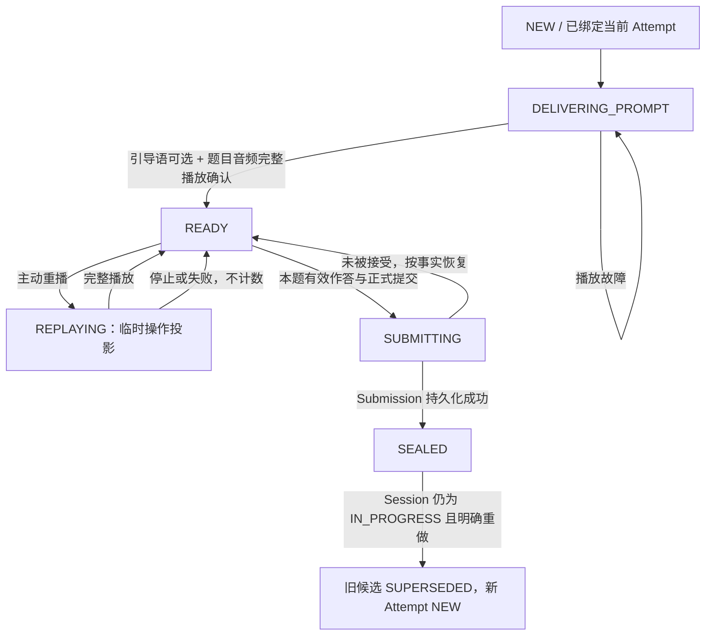

# VNext｜选择题、跟读题、问答题状态机与公共播放事实 ST1.0

> 设计日期：2026-11-13<br>
> 状态：题型专项设计草案。继承 Speaking v1.1、Dialogue v1.0、Session SW1.1、评分 S1.0、评测需求 E1.0；不直接修改代码或数据库。<br>
> 适用题型：`instruction`（图片选择／指令题）、`repetition`（跟读题）、`qa`（问答题）。

## 1. 目标和原则

三个简单题型不需要套用 Speaking 的分段录音/求助，也不需要套用 Dialogue 的逐轮动态追问。各自负责一次回答及正式提交；共享 **不可变题目语音资产、播放操作与确认、Attempt/Submission 原子身份、异步原始评价**。

已经确定的跨域约束：

- 题目首次进入及页面恢复不能随意新建 Attempt；`SessionTask` 当前只允许一个有效作答候选。
- 儿童主动“重新播放”构成**独立播放操作**。只有播放自然完整结束，并且对应完成确认被服务端接受，才产生有效重播事实。首次正常播放、可选测试员引导语、系统技术恢复播放均不属于儿童主动重播。
- `replay_count` 是从当前 Attempt 中有效主动重播事实**派生**的值，不由客户端自增，也不是不加区分的 `all_play_count - 1`。
- 原始评价在 Submission 接受后按冻结的 EvaluationPlan 异步执行；单题转换分由 `score_task()` 在正式评分批次中计算；题型 Handler 不执行重听扣分。
- 显式整题重做后，旧 Submission 退出候选；新 Attempt 尚未提交则题目未完成、Session 不能关闭。`INPUT_CLOSED` 后不可重做或恢复作答。
- 不预设重播业务次数上限、按年龄限制重播、强行规定录音时长、固定扣分公式，也不因技术防御习惯引入不必要的业务限制。

## 2. 公共播放语义

### 2.1 各类播放的身份不同

| 播放来源（逻辑 kind） | 说明 | `replay_count` 是否增加 |
|---|---|---|
| `GUIDE` | 首次进入时，非空的测试员引导语；在原题之前播放 | 否 |
| `INITIAL_PROMPT` | 冻结 TaskRevision 中题目内容的正常首次播报 | 否 |
| `USER_REPLAY` | 儿童在允许的时机主动点击“重新播放”，再次听当前题目语音 | **完成交付后增加一次** |
| `TECHNICAL_RETRY` | 同一次业务交付因网络、播放错误等进行技术恢复（可通过原操作身份表达） | 否 |

对于这三类简单题，**主动重播的对象始终是原题题目语音，不包含引导语**。首次播放“引导语 → 题目语音”；引导语为空则直接播放题目。题目文本和音频绑定已发布、被冻结的 TaskRevision，刷新页面不得切换成题库新版本。

注意：上述 kind 是**业务语义**，不是要求立刻建立一张新的配置表或拆出四个类；现有公共播放记录完全可以用 `source` / `purpose` 等字段表达。

### 2.2 唯一计数依据

一次有效 `USER_REPLAY` 的最小事实：

1. 服务端确认该 Attempt 允许主动重播，返回本次稳定的 `playback_id` 及对应冻结音频资源。
2. 客户端**实际开始**播放；仅请求资源或预加载不构成播放完成。
3. 客户端收到同一音频的**自然播放结束**事件，使用同一个 `playback_id` 上报完成。
4. 服务端幂等接受完成：同一 ID 的重复回执只算一次；失败、中途停止、切页打断或未完成均不计有效重播。

```text
replay_count = COUNT(当前 Attempt 中 kind=USER_REPLAY 且状态为 COMPLETED 的独立播放操作)
completed_prompt_play_count = COUNT(当前 Attempt 中已完成的 INITIAL_PROMPT、USER_REPLAY 等真实题目播报操作)
```

`completed_prompt_play_count` 可用于诊断**实际题目播放完成次数**；`replay_count` 才是供评分插件使用的**有效儿童主动重听次数**。两者不应混为一谈。可由播放操作推导，不要求存两套可被随意改写的权威计数器。`GUIDE` 不在题目语音完成次数里。

### 2.3 最小公共交互协议（仅表达语义）

| 操作 | 必要效果 |
|---|---|
| `get_state` | 查询当前 Attempt、播放状态、冻结音频引用、已确认有效重播次数、允许动作 |
| `start_prompt_playback` | 为首次题目播报或明确主动重播登记稳定操作身份；重复请求同一身份不创建新操作 |
| `complete_prompt_playback` | 仅对已存在、匹配当前 Attempt 的操作确认完整播放；重复 complete 幂等 |
| `mark_playback_failed` / 查询恢复 | 标记或识别本次未成功交付，释放独占播放，不增加有效重听次数 |
| `submit` | 将已合法完成的作答事实与**当前已确认**的重听事实一起冻结进 Submission |

**防止提交竞态**：若客户端已完整播放但完成回执尚未得到服务端确认，应先使用同一 `playback_id` 重传确认，再提交。本题是否已经完成和提交是否成功，以服务端最终事务为准。失败的回执不自动算成功，也不允许提交后迟来的完成回执偷偷修改已冻结 Submission。

**少做而不是多做**：不为此设计细粒度秒级续播、全套音频取证、自动多层补偿或人为的重播次数上限；仅保证合法操作身份、幂等确认和正常恢复。

## 3. 统一最小流程



- `REPLAYING`、`SUBMITTING` 在多数实现中可以只是**当前独占操作投影**，不是额外持久业务枚举。
- 音频播报期间暂停与之冲突的作答、提交和再次重播；完成或失败都应解除占用。
- 正式提交成功后可以进入下一题；后台 ASR、ISE、LLM、单题分值转换的完成时间**不阻塞已接受的 Submission**。
- 任何页面刷新、短时断网或儿童／高级界面模式切换，都读取原 Attempt 的权威进度，不自动新建 Attempt、不自动添加重听事实。

## 4. 三个题型的精简状态机

### 4.1 选择题：`instruction`（图片选择）

**输入**：已发布题干音频、冻结的选项图片、儿童选中的选项 ID。正确选项由服务端使用冻结 TaskRevision 判定，不下发到儿童作答界面，不暴露答案说明。

流程：`DELIVERING_PROMPT → READY → 选择选项 → SUBMITTING → SEALED`。

- 在 `READY` 且无播放冲突时可以点击重听；只重播题干，不重播引导语。
- 提交前儿童可以更换选中项；**正式提交**只接受所提交的最终选项身份，不将每一次选中状态算作 Submission。
- 服务端保存 `selected_choice_id` 与有效重播事实。是否正确属于由服务端确定的选择事实；五分制得分、重播扣分由插件 `score_task()` 处理。
- 不因本题是“指令题”就强制调用 ASR、LLM 或 ISE；只有冻结 EvaluationPlan 要求的评价来源才会执行。

### 4.2 跟读题：`repetition`

**输入**：已发布跟读文本及语音、儿童本题正式录音、有效重播事实。

流程：`DELIVERING_PROMPT → READY → RECORDING → 音频提交中 → SEALED`。

- `READY` 无录音/上传/提交冲突时允许重听；儿童重听只播放题目原声。
- 一旦本次有效录音被服务端接收并与当前 Attempt/Submission 原子关联，即构成正式提交；**不要求讯飞 ISE 已经完成**。
- 讯飞 ISE 如被当前评分方案声明需要，则后续 Worker 从已保存音频与冻结跟读目标调用、保存原始分；不可在此提前除以 20 或扣重播分。
- 音频已被正式接受后，即使 ISE/网络评分失败，也只恢复后台技术步骤，不因此让儿童重读；用户明确选择整题重做则创建新 Attempt。

### 4.3 问答题：`qa`

**输入**：已发布题目及引导语、儿童本题正式录音、有效重播事实。

流程：`DELIVERING_PROMPT → READY → RECORDING → 音频提交中 → SEALED`。

- 交互上与跟读题相同；区别仅在后台评价：当前冻结需求若包含 ASR/LLM，则经识别转写后做内容评分；本地声学或可选 ISE 仅按方案需要时调用。
- 没有评分需求就不调用对应接口；**特别是不需要开放题 ISE 时不得产生讯飞 ISE 请求**。
- 不采用 Speaking 的主动求助、累计分段、额外讲述时长等规则；不采用 Dialogue 的多轮追问。
- 语音内容是否切题、内容评分档位等由 LLM 的原始评价合同及后续 `score_task()` 处理，不作为本题录音提交的前置门槛。

## 5. Attempt、Session 与评分插件边界

- `Attempt` 持有一次正式作答的播放和提交事实；`Submission` 固定一次已被接受的答案和对应已确认的重听事实。历史记录保留审计但不计入当前候选。
- 显式重做 `A → B` 必须在同一事务中使旧 A 退出候选；B 的播放次数从它自己的 Attempt 事实计算，不把 A 的重听带入。
- Session `INPUT_CLOSED` 时冻结当前各题 Submission；此后不能重听、重录、改选、重做或撤回结算。
- `RawEvaluation` 保存评测原始证据；`score_task()` 消费同一 Submission 的必要评价与 `replay_count`，完成单题转换；`score_paper()` 汇总全卷，可在教师复核覆盖分后重复执行。
- 题型 Handler 不决定固定的重听扣分标准，也不把 `completed_play_count - 2` 等历史特定扣分策略写成公共事实。
- 对儿童的正式成绩只能来自持久化的最终 ScoreResult；提交后等待后台评分的过程不展示中间分数。

## 6. 示例和边界

| 过程 | 当前 Attempt 有效重听次数 | 解释 |
|---|---:|---|
| 首播引导语、首播原题，均完成 | 0 | 两种正常初始交付均不属于主动重听 |
| 首播原题播放失败后，技术重试成功 | 0 | 恢复原交付，不代表儿童额外选择重听 |
| 儿童点击重听，完整播放一次 | 1 | 一个完成的主动重播操作 |
| 同一播放操作 `complete` 回执重传三次 | 1 | 仍是同一个操作身份 |
| 儿童两次独立点击重听，第一段中途关闭、第二段完整播放 | 1 | 只计算完成的一段 |
| 儿童明确重做，旧 Attempt 已重听 3 次，新 Attempt 尚未作答 | 新 Attempt 为 0；该题尚未完成 | 不继承旧重听，也不允许旧提交兜底 |
| 成功关闭 Session 后再点重听 | 不变化 | 服务器拒绝后续作答操作 |

## 7. 定向验收（初版）

1. 三题型均严格采用冻结 TaskRevision 的引导语、题干和音频；可选引导语为空时跳过，不播放占位语音。
2. 首次进入实际播放顺序为可选引导语后接题目；“重听”仅重播题目，不重复测试员引导语。
3. 首播完整交付后 `replay_count=0`；点击一次完整重听后为 1；不同两次完整重听后为 2。
4. 点击重听但中断、切页、播放报错、仅预加载或播放完成未被接受均不计有效重听。
5. 同一播放操作的请求、完成回执重复发送均不重复增加重听；客户端不能独立修改权威值。
6. 录音或提交期间不能同时启动重听；失败恢复后不留下永久冻结的按钮。
7. 选择题保存最后正式提交的选项身份；服务端正确选项不泄漏给儿童端。
8. 跟读题、问答题已上传录音并正式提交后，允许先进入下一题；后台评测失败可恢复，不要求儿童重新录音。
9. 不需要 ISE 的问答题评测路径中，正常处理及后台扫描重试均不会生成 ISE Job 或请求。
10. 有效重播、录音及当前 Attempt 身份一起冻结在正式 Submission；迟到回执不能在提交后改变计分事实。
11. 整题重做使 A 立即退出候选；新 B 未提交前 Session 关闭失败；B 的重播计数只取 B。
12. `INPUT_CLOSED` 后禁止重播、重录、改选、重做或撤回，不触发中间成绩展示。
13. `score_task()` 只在正式评分阶段读取冻结评价与重播事实；题型流程中不提前进行重听扣分。
14. 两种语音题型不引入 Speaking 求助、Dialogue 轮次、无依据的录音时长门槛或任意播放次数上限。

## 8. 实施备注

公共部分只需要：**获取冻结题目音频、登记独立播放操作、自然完成确认（幂等）、派生有效主动重听次数**。其余选择、录音、上传、正式提交由各自轻量 Handler 处理。不要为三个简单题型造一套包含未来所有可能流程的大状态机。

建议与上位文档整合时明确：旧版 `completed_play_count` 包含首次播放，且部分规则以 `completed_play_count - 1` 推得重听；VNext 统一改为显式 `USER_REPLAY` 成功事实计数，避免测试员引导语、技术恢复或多段交付扰动结果。历史分数公式仍属于各版本评分插件，不属于题型 Handler。
