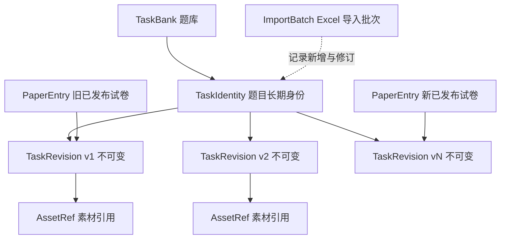
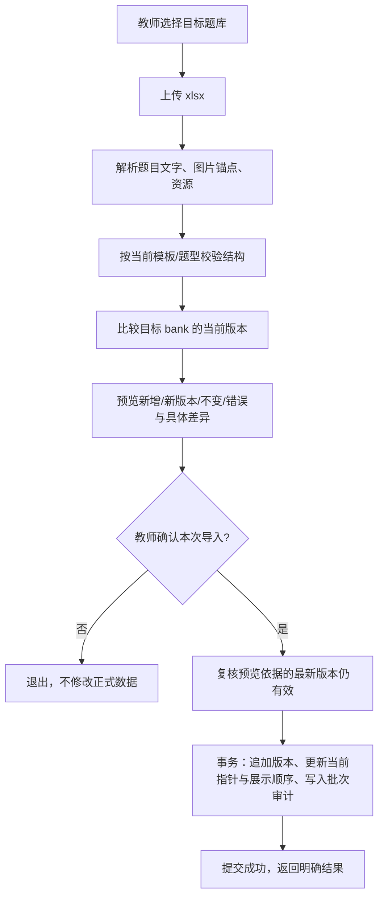

# VNext｜题库、题目版本与 Excel 导入专项设计 T1.4

> **状态：设计讨论稿（16 列重新编排、删除题目名称及小程序替代展示已确认，评分说明语义已更正，其余部分保留原讨论层级）** 
> **更新日期：2026-11-12** 
> **建议仓库路径：** `docs/design/taskbank-version-and-import.md` 
> **上位约束：** `AGENTS.md`、`VNEXT_INITIAL_ARCHITECTURE_DESIGN.md`；Speaking v1.1、Dialogue v1.0 及后续确认的题型决策 
> **样本：** `v2_小班样卷(1).xlsx`、`v2_中班样卷(1).xlsx`、`v2_大班样卷(1).xlsx`（用户提供）

## 0. 文档效力

- **【已确认】**：此前讨论中用户明确决定的规则；实施时不可擅自改变。
- **【建议】**：实现已确认规则的最小必要设计，允许经讨论优化。
- **【待确认】**：对现有约定还存在解释空间，不允许开发者直接猜定。
- 题库领域负责**题目身份、内容修订、素材关联与导入版本**；不直接控制儿童 Attempt、题型交互、评分算法或整卷正式结算。
- Excel 是**题目内容创建与修改的唯一日常入口**；不额外实现网页逐题编辑按钮。题库创建、查看、检索、组卷和必要的归档管理不等同于网页编辑题干。
- 旧系统仅供事实参考，不沿用全局题号冲突时迁移题库、原地覆盖题目、已发布试卷“偶然不变”的隐式设计。

## 1. 样卷事实基线

三份工作簿均含 `题库导入`、`填写说明` 两张工作表，导入表为 `A1:S11`，19 个字段、10 道题。题型分布：

| 学段样卷 | 指令题 | 跟读题 | 问答题 | 对话题 | 说话题 | 合计 |
|---|---:|---:|---:|---:|---:|---:|
| 小班 | 5 | 3 | 1 | 1 | 0 | 10 |
| 中班 | 5 | 3 | 0 | 1 | 1 | 10 |
| 大班 | 5 | 3 | 0 | 1 | 1 | 10 |
| 合计 | 15 | 9 | 1 | 3 | 2 | 30 |

旧样卷实际存在 **49 张嵌入图片**：45 张位于指令题的旧 J/L/N 选项列，4 张位于旧 R 列的开放题配图。新版模板精简和重新排序后，图片锚定位置改为 **H/I/J（选项 A/B/C）及 L（题目图片）**。导入必须依模板版本与列名解析对应图片锚点，而非仅取 `cell.value`。

旧《填写说明》保留“题目编号全局唯一、同编号更新”的描述，应随 VNext 模板改为**同一题库内唯一身份、修改产生新版本**。旧说明对 S 列“一律暂空”的叙述与样卷内对话/说话题已填入的追问范围不完全一致：**以实际样卷内容为测试输入，更新说明文案，不清空已填内容**。新版追问范围在 P 列，不可把旧 S 列直接当成新版 S 列。

## 2. 对象与权威身份

### 2.1 TaskBank【已确认】

- 独立题库身份 `bank_id`，维护名称、说明、展示/归档等管理元数据。
- 不同题库之间**绝不因为题目编号或题目内容相同而共享题目业务身份**。
- 一道题目长期属于一个题库；向另一个题库导入相同编号，是另建一条独立身份，不是迁移原题。
- 题库不必被固定学段约束死：`学段` 属于题目修订的上下文/检索属性，不是某个题型可用与否的权限白名单。

### 2.2 TaskIdentity【已确认】

- 稳定内部主键 `task_id`；所属 `bank_id`；教师在 Excel 中填写的题目编号 `task_code`。
- 身份唯一约束：`UNIQUE(bank_id, task_code)`。
- `task_code` 由教师指定；**不需要系统判断新内容是否与原内容“足够相似”**。
- `grade_level`、`task_type`、题目内容属于可修订的题目版本信息，不能使相同编号被全局阻断或意外迁移题库。
- 当前可展示版本可由最高有效版本/明确 `current_revision_id` 确定；不可用两套可被分别修改的权威来源导致分歧。

### 2.3 TaskRevision【已确认】

- 内部稳定主键 `task_revision_id`；对应 `task_id`、`version`、内容字段、素材引用、创建时间、来源导入批次、内容指纹。
- `UNIQUE(task_id, version)`；版本号由系统生成并在同一题目身份内单调递增（v1、v2、v3……）。
- 已创建的修订内容**不可原地修改**；历史修订需可查询。
- 题目 ID 相同而内容完全不同、学段变更、题型变更、Dialogue 目标轮数变更，均可以产生新版本；不进行内容相似度审核。
- 只有**与当前最新版本**内容相同的重复导入才视为“不变”。若先有 v1=A、v2=B，后来重新导入 A，应创建 **v3=A**，而不是回退当前指针到旧 v1。
- 同一版本可被多个已发布 PaperEntry 引用；共享不可变版本数据不代表共享试卷中的作答状态。

### 2.4 Asset【建议】

- 图片等题目素材有稳定引用、原始文件类型、必要完整性指纹及归属引用；可进行底层文件复用，但**不同题库的题目身份仍完全独立**。
- 题目修订对素材引用不可变。覆盖同一路径的文件来“更新图片”不可接受；图片变化应产生新的修订引用。
- 发布准备的 TTS 派生音频属于 Paper 发布资源；相同题干的 TTS 重新制备，不应反过来制造一个新的题目内容版本。

### 2.5 ImportBatch【建议】

保存目标题库、上传文件指纹、预检摘要、操作结果（新增身份/新版本/不变/错误）、提交身份、执行时间。它是审计和幂等辅助，不是另一份可编辑题库。

## 3. Excel 导入字段合同：16 列 T1.4 排列【已确认】

**正式 VNext 模板仍为 A:P 共 16 列。** 以原始 19 列样卷为基线，新增 Dialogue 的「目标对话轮数」，删除「题目名称」及三项独立「选项说明」。教师按**题目基本信息 → 引导和题干 → 题型配置 → 图片/材料 → 参考及 AI 配置**的顺序填写。

| 新列 | 字段 | 业务语义 | 填写与校验原则 |
|---|---|---|---|
| **A** | 题目编号 | `task_code`，所选 TaskBank 内长期身份 | 作为文本读取，保留前导零；不要求跨题库全局唯一 |
| **B** | 学段 | 题目上下文、筛选属性 | 不当作题型可用性白名单 |
| **C** | 题型 | `task_type`，选择已注册题型 Handler | 小程序按映射展示中文题型名称 |
| **D** | **排序号** | 题库展示顺序元数据 | **不参加内容指纹、不生成题目修订版本**；已发布 PaperEntry 有独立题序 |
| **E** | 测试员引导语 | 首次固定介绍／引导文本 | 不与 F 的题干合并；按题型已确认交互使用 |
| **F** | **题目内容** | 儿童实际需要回答、跟读或执行的核心题干 | 属于版本化内容；不得拿题型显示文本充当题干 |
| **G** | **目标对话轮数** | Dialogue 专属 `target_rounds` | Dialogue 使用有效正整数，随试卷引用的题目版本冻结；无任意三轮上限 |
| **H** | 选项 A 图片 | 指令/选择题选项 A 的嵌入素材 | 从图片锚点读取 |
| **I** | 选项 B 图片 | 指令/选择题选项 B 的嵌入素材 | 同 H |
| **J** | 选项 C 图片 | 指令/选择题选项 C 的嵌入素材 | 同 H |
| **K** | 正确选项 | 对应 A/B/C 选项的正确身份 | 匹配有效选项身份；不强加给非选择题 |
| **L** | **题目图片** | 开放题等场景配图 | 从图片锚点和题目所在行绑定 |
| **M** | **材料说明** | 对题目图片／场景／材料的客观描述 | 紧随配图，保留独立语义；不是儿童原话 |
| **N** | **参考答案** | 题目参考文本或示例 | 不当作开放题唯一合法表述 |
| **O** | **评分说明** | 教师填写、供适用题型的 LLM 评分调用使用的提示词/评分要求 | 属于 TaskRevision 版本化内容；按题型评测合同传入 LLM，非整卷换算算法 |
| **P** | **AI 追问范围** | Speaking／Dialogue 的引导话题边界 | 不混入儿童 ASR 文本，不决定自动结束 |

### 3.1 移除「题目名称」并明确小程序显示合同【已确认】

历史 Excel `题目名称` 仅供管理识别；**VNext 不再要求 TaskRevision 保存独立的题目标题字段**。儿童小程序原显示题目名称的位置，统一改为显示**中文题型名称**：

| `task_type` | 显示文字 |
|---|---|
| `instruction` | 选择题 |
| `repetition` | 跟读题 |
| `qa` | 问答题 |
| `dialogue` | 对话题 |
| `speaking` | 说话题 |

**旧系统只读代码审计证据（2026-11-12，旧仓库 `main`）**：`miniprogram/pages/assessment-task/assessment-task.wxml` 的多个任务列表位置及 `image-choice-task`、`repetition-task`、`qa-audio-task`、`dialogue-task`、`speaking-task` 的 WXML 均引用 `task.title`；`miniprogram/pages/qa-audio-task/qa-audio-task.js` 的 `readPrompt` 使用 `task?.prompt_text || task?.title || ""`；旧后端 `TaskDefinition` 和 `task_snapshot` 也包含 `title`。因此改造范围绝非只删 Excel 一列，还要同步更新**发布快照、API 投影、子页面、任务列表与读取题干的回退逻辑**。

- 题目内容的权威字段仍是 `prompt_text`（或新版等价的题干字段）；**禁止以题型显示名称作为题目内容或 TTS 朗读的兜底**。
- 儿童作答页仅展示题型中文名称，而不是题干摘要作为标题；真实题干在内容区另行展示。
- 教师题库管理列表为了定位题目，可继续使用「题目 ID＋题型＋题目内容摘要」的**派生视图**，但不得偷偷复活可编辑 `title` 字段。
- `task_type` 仍保留原稳定内部类型标识，不把中文显示名写入数据库作为题型主键。旧已发布试卷保留其既有历史快照原样，VNext 新投影可以忽略旧标题，不得改写历史证据。

### 3.2 移除选项说明、保留材料说明【已确认】

图片选择题的三张选项图和 K 列正确选项构成答案依据。删除 A/B/C 三个独立说明字段；**不得将这些说明作为合法导入的必填项**。L 列题目图片与 M 列材料说明彼此相邻，材料说明供教师审阅及已明确需要的题型上下文使用；不与可执行评分算法或儿童 ASR 混用。

对于旧版样卷，不自动把已经废弃的三列说明拼接到 M 列；是否保留必要旧内容由教师在新版 Excel 中填写。材料说明属于题目版本内容。

### 3.3 图片、版本与旧模板迁移【已确认】

- **D 排序号**：仅属于题库展示元数据，不参与内容指纹；修改排序号不产生修订版本，不影响已发布 `PaperEntry.position`。
- **G 目标对话轮数**：由每道 Dialogue 题目明确配置，在 Paper 发布时冻结所引用的题目版本；旧模板无此字段，不能擅自设定旧系统两到三轮默认值。
- **图片槽位**：旧模板的 J/L/N（选项 A/B/C）、R（题目图片）→ 新模板 **H/I/J/L**。必须结合模板列名和图片锚定行列解析；不可把没有 `cell.value` 的图片误判为空。
- **模板兼容**：旧三份 19 列文件不能按新的 16 列位置静默读取。可以明确拒绝旧模板或走显式迁移流程；特别处理删除的名称/选项说明及新增 G 轮数。
- **版本判定**：移动字段的列位置本身不构成内容变化；应按规范化字段语义与图片内容比较，而不是比较整行 Excel 二进制或列位置。

### 3.4 评分说明的实际作用及与评分插件的边界【已确认】

- **O 列由教师在创建/修订题目（Excel 导入）时自主编写**；其内容是供对应 LLM **执行原始评价**时使用的题目级评分提示词，可包括具体观察维度、评价依据和注意事项。
- 只有实际使用 LLM 原始评分的题型/评测通道才按照各自合同消费 O 列；选择题等不依赖 LLM 评分的题型，不得因为有 O 列就被强行送给模型或让其参与自动判分。
- O 列随 TaskRevision 不可变，修改它会创建新版本；已发布 PaperEntry 仍指向旧版提示词。LLM 返回的**原始评分证据**另行保存，包含必要的模型、提示词/规则版本与来源信息，以便追溯。
- O 列**不是**评分插件执行的 Python 代码，也不是对原始分进行换算的权重、总分公式或档位配置。评分算法插件由试卷指定，负责处理已产生的原始评分事实。
- 原始评分产生过程属于题型 Handler 与评测适配层，评分插件不得反过来操纵 Dialogue 轮次、Speaking 求助或儿童作答流程。

## 4. 内容指纹与“是否产生新版本”【建议】

版本比较以**目标题库中的当前最新 TaskRevision** 为基线，使用导入后规范化的**业务内容**，而非 Excel 整份文件的二进制散列。

**计入内容指纹**：B/C、E/F/G（Dialogue 目标轮数）/M/N/O/P 等实际业务文字和配置，以及 H/I/J/L 题目图片、K 正确选项；图片按稳定内容指纹比对，而不是按 Excel 文件名判断。题目编号 A 为身份索引，不是修订内容；被删除的题目名称和三个选项说明不再参加内容比较。

**不计入内容指纹**：D 排序号、导入文件名、工作表样式、列宽、图片在合法单元格中的缩放/偏移、上传时间、导入批次等非题目内容元数据。

判定规则：

1. 当前题库中不存在该 `task_code` → 创建 TaskIdentity + v1。
2. 存在，导入业务内容与当前版本一致 → `UNCHANGED`，不创建版本；若 D 排序号变化，可单独更新排序投影。
3. 存在，导入业务内容与当前版本不同 → 创建 vNext，并设为当前版本；不判断是否“改动太大”。
4. 同内容在另一个题库导入 → 另建该题库自己的 TaskIdentity + v1。
5. 历史版本内容重新出现且与当前不同 → 仍创建新的递增版本，而不是把当前版本指针回滚到历史版本。
6. 因修订造成类型变化，例如原 Dialogue 变 Speaking，按新题型数据合同校验本次内容，校验通过便正常创建新版本。已发布的旧 Dialogue PaperEntry 仍指向旧版本。

空白语义：本次导入行是**一份完整的新内容定义**，允许为空的字段留空就是把该字段置空，而非默默继承旧版本的值。图片清空同理。否则教师无法真正删除过时的引导或素材。必填字段空白则在预检明确报错。

**不得**采用 AI 语义相似度、变动幅度打分、文本改动阈值决定是否准许新版本。Excel 提交即代表教师的内容意图。

## 5. Excel 导入契约：预检与原子提交

### 5.1 预检【建议】

- 教师端选择**唯一明确的目标 TaskBank**；不根据题目 ID 或学段自动决定/迁移题库。
- 必须读取 xlsx 的结构化单元格与**嵌入图片锚点**；不存在图片字符串不意味着图片缺失。
- 校验字段类型、已注册题型、图片位置与归属、关联的必需素材/正确选项、Dialogue 正整数轮数等**技术与明确业务合同**。
- 不进行题目内容的“适龄性合格”“重复提问质量”“改动幅度”自动审核，更不因评价失败阻断导入。
- 预览每题：`NEW` / `NEW_REVISION (vN→vN+1)` / `UNCHANGED` / `ERROR`，展示实际文本和图片变化摘要。
- 同一工作簿/目标题库出现重复 `task_code`：内容相同可以合并并提示；**内容冲突则报告行号，不能悄悄选择最后一行**。这是输入歧义，不是内容质量审核。
- 工作簿**缺少某道旧题**不触发删除、归档或重新排序其他旧题。
- 旧 19 列历史样卷的适配必须显式处理**列重排、四列删除及新增 G 列轮数**；不能只补一列，也不能使用隐藏默认值制造“假正确”。

### 5.2 提交【建议】

- 采用 **整批原子提交** 作为初版：一旦预检确认的批次存在结构错误，先拒绝批次提交，允许教师修正 Excel 再导入；不悄悄仅导入一部分。
- 预检与确认之间如果别人已经更新相同题目，提交时检测基线不一致并要求重新比较；不在陈旧预览上无声覆盖并创造异常版本。
- 图片先准备为可可靠引用的资源，再以数据库短事务写入题目身份、版本、当前版本关系、排序元数据和批次结果。数据库事务不依赖同时回滚文件系统；多出的未被引用暂存文件可以清理。
- 并发导入同一 `(bank_id, task_code)` 需要数据库条件校验和唯一约束；两个确认请求不能生成相同版本号或破坏当前版本链。
- 重复网络提交使用稳定 `import_operation_id` 返回原有结果；即使使用新的操作 ID 重新导入相同的当前业务内容，也按内容比较返回 `UNCHANGED`，不重复创建无意义版本。
- 避免每次导入都复制完整图库；可复用内容完全一致的底层 Asset，但不同题目的业务关系仍保持独立。

### 5.3 导入结果可追溯【建议】

一次提交至少能查询：目标 bank、源文件摘要、参与行数、新建题目数、新版本数、不变数、结构错误数、各编号前后版本、导入时间和触发者/操作来源。导入后的版本无法无痕原地撤销；恢复到历史内容可通过再次导入而产生下一版本。

## 6. 教师端管理与操作边界

### 6.1 题库管理界面【已确认 + 建议】

- 可创建/重命名题库、选择目标题库、查看题目、查询历史版本、预览图文内容、检索/筛选（学段、题型、编号）、导出题目与导入报告。
- **不提供网页单题编辑/新增内容按钮。** 教师需要变更内容时下载模板或导出现有题目，调整 Excel 再导入。
- 默认列表展示最新版本，但应能明确看到版本号和必要历史。历史版本建议可读、不可编辑。
- 归档/恢复展示属于目录管理，不允许物理删除被历史 Paper 引用的 TaskRevision；是否在网页提供归档按钮【待确认】，不影响版本核心合同。
- 高级模式是**儿童小程序的纯 UI 展示状态**，不应用于教师题库管理权限或 TaskRevision 身份。

### 6.2 D 列 `排序号` 的确定规则【已确认】

三份旧样卷的排序号均为 1～10，但这不意味着题库就是试卷。新版 D 列只代表**目标题库内部的展示排序**，不计入 TaskRevision 内容指纹。题库列表及组卷时的候选题列表可以按此顺序呈现，供教师参考难度节奏；**正式试卷的确定顺序只能由 `PaperEntry.position` 保存**。

- 教师仅调整 D，不新建内容版本；导入可在同一事务中更新 TaskIdentity 对应的展示顺序。
- 已发布试卷顺序与历史题目内容均不受 E 更新影响。
- D 不要求全题库唯一；排序号相同时使用稳定的二级排序规则，不能据此创造额外版本。
- 若后续要开发“按题库顺序自动组卷”，必须作为明确的组卷策略另行设计，不能让 D 隐式决定正式发布次序。

## 7. 与 Paper、Attempt、评分的隔离

- 草稿组卷选择**具体的 `task_revision_id`**（通常默认最新版本），不存 `task_code` 后在发布时才临时查“最新内容”。
- 发布 Paper 后，PaperEntry 对特定版本的关联、题目顺序、固定题干/素材和必要固定 TTS 资源均不可变。历史版本和图片必须保留，不因题库后续导入清理。
- Dialogue 的 `target_rounds` 是**题目版本内容字段**，随已发布 PaperEntry 冻结，不能沿用总体初稿所说“所有 Dialogue 轮次均是运行时可变政策”。应同步修订该旧表述。
- Speaking 最低录音时长属于已另行确认的**未提交 Attempt 运行政策**，**不要求塞进题库 Excel**，也不能和 Dialogue 的固定轮数混用。
- **O 评分说明是教师可编辑、版本化的 LLM 原始评分提示词**，应按适用题型评测合同传入模型；N 参考答案作为题目参考数据，其是否进入评测请求由该题型合同决定。O 并非单纯教师备注，更不是可执行评分算法。正式的原始分折算、权重与总分档位由已发布 Paper 选定的代码评分插件确定。
- `SessionTask` 继续轻量引用 `PaperEntry`；Attempt/Submission 保存儿童自身运行事实，不反向修改 TaskRevision。
- 旧题目版本若被归档，其已发布 Paper 及历史 Session 仍必须能够查询完整题干、图片、题型和评分参考。

## 8. 最小数据库结构建议

| 结构 | 核心字段 / 约束 | 说明 |
|---|---|---|
| `task_banks` | `id`, `name`, `metadata`, `archived_at?` | 题库稳定身份 |
| `tasks` | `id`, `bank_id`, `task_code`, `current_revision_id?`；`UNIQUE(bank_id,task_code)` | 长期题目身份 |
| `task_revisions` | `id`, `task_id`, `version`, `content`, `content_hash`, `created_at`, `import_batch_id`；`UNIQUE(task_id,version)` | 不可变的题目具体版本；业务内容可用清晰的 typed 列/有版本 JSON，选型另审 |
| `assets` | `id`, `content_hash`, `storage_ref`, `media_type`, `metadata` | 可靠图片资源 |
| `task_revision_assets` | `task_revision_id`, `slot`, `asset_id` | 例如 `option_A`, `option_B`, `option_C`, `question_image` |
| `task_bank_order`（或 tasks 字段） | `task_id`, `display_order` | D 排序元数据，不与正式试卷 position 混淆 |
| `import_batches` | `id`, `bank_id`, `operation_id`, `source_hash`, `status`, `report` | 导入审计与幂等 |
| `paper_entries` | `paper_id`, `position`, `task_revision_id`, `published_resource_ref?` | 发布后固定题目版本，内容只读 |

以上是**关系及约束建议，不要求逐字照搬表名、全部单设数据表或为了防御进行过度拆分**。

## 9. 关键验收测试（建议首批）

1. 题库 A 的 D001 首次导入创建 v1；重复相同内容不产生新版本。
2. 题库 A 的 D001 修改一个字，创建 v2；完全修改成新题，正常创建 v3。
3. 题库 A 的 D001 与题库 B 的 D001 互不关联，导入 B 不移动 A。
4. 内容 A→B→A 连续导入，产生 v1/v2/v3，而不是重置历史版本指针。
5. 更换学段或题型后，在新类型合同通过的情况下正常创建版本，不触发学段题型白名单。
6. 已发布旧 Paper 引用 v1，教师导入 v2 后仍播放/显示 v1 的题干和图片。
7. 同一个 XLSX 只改变样式、列宽、图片显示大小，不产生新内容版本。
8. 嵌入图被替换而文字不变，产生新内容版本；同图重复导入不产生版本。
9. 迁移样卷的 45 个指令选项图和 4 个开放配图后，与**新版 H/I/J/L 正确的题目行及槽位**关联；图像不会因单元格文本为空而丢失。
10. 仅修改 D 排序号，改变题库显示投影，不影响版本号或历史已发布试卷顺序；组卷候选列表可参考排序，但发布时由 PaperEntry 决定正式次序。
11. 同一编号在单次导入中出现互相冲突的两行，报告准确行号并停止原子提交，不静默选择覆盖。
12. Excel 缺少已存在的题目，不自动删除或归档该题。
13. 预览基线被其他导入修改后，旧预览不能静默覆盖；要求重新比对。
14. 并发导入或重复确认相同内容，无法产生重复 `(task_id,version)`，结果幂等。
15. 批次中任一条结构错误，不发生部分题目已更新、部分失败的静默状态。
16. Dialogue 缺失 G 列 `target_rounds` 不偷偷默认三轮；1、4、6 等正整数如业务合法均允许。
17. Dialogue 从 2 轮改为 4 轮生成新修订；已发布旧 Paper 仍按原版本两轮执行。
18. Speaking/Dialogue 的 AI 追问范围保存为内容约束，不被当作儿童 ASR 文本或正式评分算法。
19. O 评分说明修改产生新题目版本；新试卷的适用题型 LLM 原始评分使用新版提示词，而引用旧修订的 Paper 仍保留原评分提示词；该修改不会改动既有 Paper 绑定的计分算法插件。
20. 重复上传同一个导入请求返回原 ImportBatch 结果；修订历史可追溯。
21. 历史修订被当前题库隐藏或归档后，已引用它的正式 Session 仍可读取完整题目内容及相关资产。
22. 教师端没有网页逐题修改入口，正常题目内容变更必须通过 Excel 导入。
23. 小程序任务列表及五种题型的原标题位置只显示中文题型名称，不再依赖 `task.title`。
24. 问答题 `prompt_text` 缺失时不会回退成「问答题」或旧 `title` 并作为真实题干/语音播放。
25. 从数据库版本、发布快照到 API 投影删除对新版 `title` 的必需依赖，旧已发布历史快照不被物理改写。
26. 新版图片正确绑定 H/I/J/L 四个槽位，参考答案、评分说明、AI 追问范围分别来自 N/O/P。
27. 对适用题型，LLM 评分请求实际接收 O 列的当前冻结修订文本；选择题及无需 LLM 的通道不强制调用模型。
28. O 列变化引起题目新修订，不影响已有 Paper 固定的旧评分提示词与代码评分插件身份。

## 10. 剩余建议与跨域事项

**已确定，不再征询**：D 排序号为独立的题库展示元数据，不参加内容版本判定，正式 Paper 顺序由 PaperEntry 独立固定；G 目标对话轮数是 Dialogue 题目版本化字段；新版 Excel 按 T1.4 的 A:P 列序执行。

尚需在后续具体实施设计中处理而非擅自设定的项目：

1. **网页归档**：是否允许将题目暂时隐藏/恢复，属于题库目录管理而非修改题干，可在管理端细化时确定。
2. **模板迁移**：现有 19 列样卷与新版 16 列的**列重排、删除字段及图片锚点迁移（H/I/J/L）**应当显式、可验证；Dialogue 必须由教师补齐目标轮数，不默默默认旧系统轮数。
3. **导入失败策略**：初版建议整批原子导入；如果将来有明确的分批导入业务需要，再增加受控分批功能，不添加不透明的“能导几道就导几道”。

题目身份、版本不可变、跨题库独立、任意内容变化都可创建新版本、Excel 唯一内容写入入口及 Paper 固定引用均为已收敛的业务基线。
